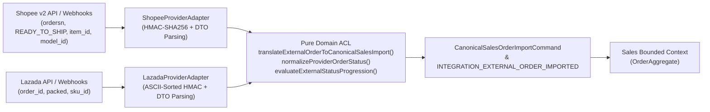

# Anti-Corruption Layers (ACL) — SapoClone

## 1. External Marketplace Anti-Corruption Layer (`apps/integration`)

External e-commerce marketplaces (**Shopee Open Platform v2** and **Lazada Open Platform**) use proprietary data models, status lifecycles, webhook signing algorithms, and rate-limit semantics that must never pollute SapoClone's internal `Sales`, `Inventory`, or `Catalog` bounded contexts.

### 1.1 Architectural Structure

### 1.2 Key ACL Translation Functions in [`integration-domain.ts`](file:///Users/mac/Desktop/SEM7/pbl6/pbl-api/apps/integration/src/domain/integration-domain.ts)

1. **Order Status Normalization (`normalizeProviderOrderStatus`):**
   - Translates Shopee statuses (`UNPAID`, `READY_TO_SHIP`, `PROCESSED`, `SHIPPED`, `TO_CONFIRM_RECEIVE`, `COMPLETED`, `IN_CANCEL`, `CANCELLED`, `TO_RETURN`) and Lazada statuses (`unpaid`, `pending`, `packed`, `ready_to_ship`, `shipped`, `delivered`, `canceled`, `returned`) into the canonical `NormalizedExternalOrderStatus` union (`UNPAID` | `READY_TO_SHIP` | `SHIPPED` | `DELIVERED` | `CANCELLED` | `RETURN_REQUESTED`).
2. **Monotonic Status Progression Guard (`evaluateExternalStatusProgression`):**
   - Prevents out-of-order webhook deliveries (e.g., `READY_TO_SHIP` arriving after `SHIPPED`) from regressing internal order state (`IGNORE_STALE`), and flags illegal business reversals (`DELIVERED` $\rightarrow$ `CANCELLED`) as `CONFLICT_RECONCILIATION_REQUIRED`.
3. **Canonical Sales Order Import Translation (`translateExternalOrderToCanonicalSalesImport`):**
   - Resolves external marketplace SKU identifiers against tenant-scoped `ResolvedInternalSkuMapping` records.
   - Quarantines orders with unmapped or inactive SKUs (`EXTERNAL_ORDER_MAPPING_REQUIRED` / `INTERNAL_VARIANT_INACTIVE`) inside the `Integration` context so invalid marketplace orders never corrupt `Sales` or `Inventory`.

---

## 2. Internal Cross-Context Reference Projections (Conformist / ACL Read Snapshots)

- **Inventory `CatalogSkuProjectionHandler`** ([`catalog-sku-projection.handler.ts`](file:///Users/mac/Desktop/SEM7/pbl6/pbl-api/apps/inventory/src/infrastructure/catalog-reference/catalog-sku-projection.handler.ts)): Translates `catalog.variant.*` and `catalog.product.deactivated` events into Inventory's minimal `catalog_sku_projection` table (`sku_id`, `sku_code`, `status`, `aggregate_version`), shielding `Inventory` from Catalog's rich product/attribute/price-list schema.
- **Sales `CatalogSnapshotService`** ([`catalog-snapshot.service.ts`](file:///Users/mac/Desktop/SEM7/pbl6/pbl-api/apps/sales/src/modules/catalog-snapshot/catalog-snapshot.service.ts)): Translates Catalog events into `AuthoritativeCatalogVariant` snapshots used by `calculateOrderQuote()` during POS and omnichannel checkout.
