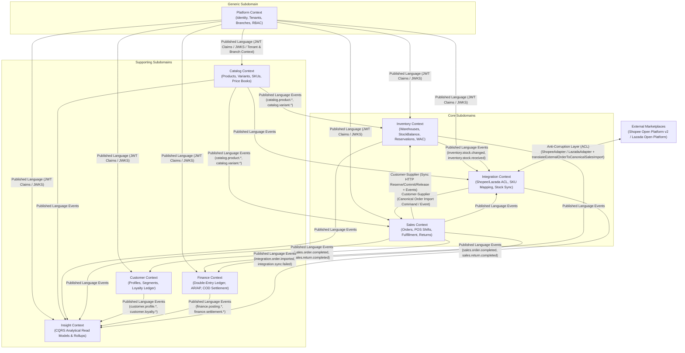

# Context Map — SapoClone Bounded Context Relationships

## 1. Context Map Diagram

---

## 2. Context Relationship Matrix

| Upstream Context | Downstream Context | DDD Relationship Pattern | Integration Mechanism | Protection / Anti-Corruption Strategy |
|---|---|---|---|---|
| `platform` | All 7 Business Services | **Open Host Service (OHS) + Published Language (PL)** | RS256 JWT + JWKS endpoint + `@pbl/auth` guard | Downstream services validate JWT signatures locally without calling Platform DB. |
| `catalog` | `inventory`, `sales`, `integration`, `insight` | **Published Language (PL)** | Outbox events (`catalog.product.created`, `catalog.variant.updated`) | `inventory` maintains local `catalog_sku_reference`; `sales` maintains `catalog_variant_snapshot`. |
| `inventory` | `sales` | **Customer–Supplier** | Sync HTTP (`ReserveStockDto`, `CommitReservationDto`) + Async Events | `Sales` uses `InventoryReservationPort` with timeout/circuit-breaker protection and idempotency keys. |
| `sales` | `customer`, `finance`, `insight` | **Published Language (PL)** | Outbox events (`sales.order.completed`, `sales.return.completed`) | Downstream consumers use `processed_events` inbox deduplication and pure domain calculators. |
| `inventory` | `integration`, `finance`, `insight` | **Published Language (PL)** | Outbox events (`inventory.stock.changed`, `inventory.stock.received`) | `integration` applies `shouldApplyInventoryStockVersion(currentVersion, incomingVersion)` to drop out-of-order stock updates. |
| External Shopee / Lazada APIs | `integration` | **Anti-Corruption Layer (ACL)** | `ShopeeAdapter`, `LazadaAdapter`, `translateExternalOrderToCanonicalSalesImport` | External provider payloads and status codes (`READY_TO_SHIP`, `packed`, `UNPAID`) never leak into `Sales` or `Inventory`. |
