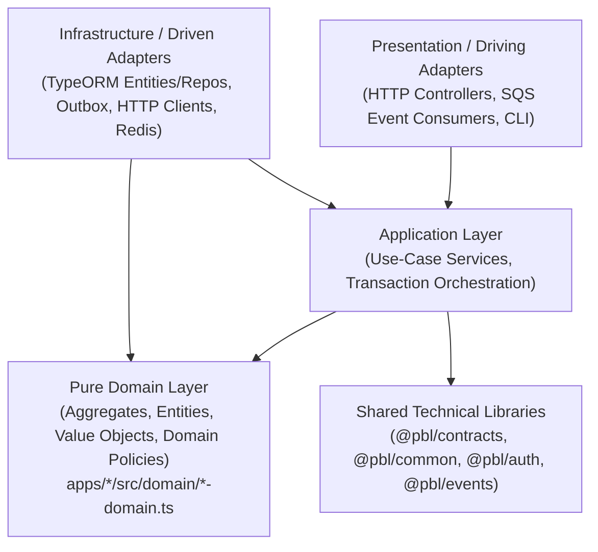

# Dependency Analysis & Hexagonal Layering Verification

## 1. Allowed Dependency Graph

---

## 2. Static Dependency Verification Matrix

| Dependency Rule | Source Scope | Forbidden Target Scope | Verification Result |
|---|---|---|---|
| **Cross-Service Isolation (Rule A)** | `apps/<service>/src/**` | `apps/<other-service>/**` | **0 Violations** across all 8 microservices |
| **Domain Purity (Rule B)** | `apps/*/src/domain/**` | `@nestjs/*`, `typeorm`, `axios`, `ioredis`, `@aws-sdk/*`, `express`, `process.env` | **0 Violations** (Fixed `process.env` in `integration-domain.ts`) |
| **Inward Layer Direction (Rule C & D)** | `apps/*/src/domain/**` | `../modules/**`, `../api/**`, `../infrastructure/**`, `../presentation/**`, `../controllers/**`, `../consumers/**` | **0 Violations** across all 8 microservices |
| **Cross-Schema SQL Isolation (Rule E)** | `apps/<service>/src/**` | SQL `FROM`/`JOIN`/`INTO`/`UPDATE` on `<other-schema>.<table>` | **0 Violations** across all 8 microservices |
| **Shared Library Purity (Rule F)** | `libs/{common,auth,contracts,events}/src/**` | `apps/**` or business `@Entity()` definitions | **0 Violations** across all 4 shared libraries |
| **Acyclic Domain Graph (Rule G)** | `apps/*/src/domain/**` | Circular relative imports | **0 Cycles** across all 8 microservices |
