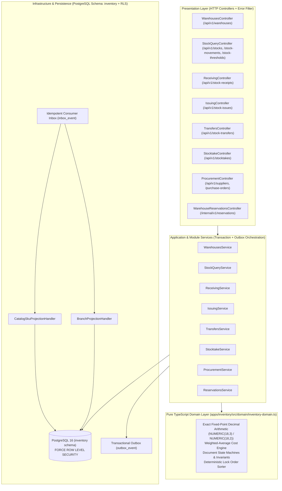

# M2 Inventory Microservice — Architecture & Service Boundary Report

## 1. Bounded Context & Ownership

`apps/inventory` (`Inventory` bounded context, port `3013`, PostgreSQL schema `inventory`) is the **single authoritative source of truth** in SapoClone for:

- **Physical & Logical Warehouses (`warehouse`):** Branch-attached (`BRANCH`), central distribution (`CENTRAL`), and quarantine/return (`QUARANTINE`) warehouses, including per-branch default fulfillment routing (`is_default`) and safe deactivation lifecycle (`ACTIVE | INACTIVE`).
- **Authoritative Stock Balances (`stock_balance`):** Exact `NUMERIC(18,3)` quantities (`on_hand_qty`, `reserved_qty`, `available_qty = on_hand_qty - reserved_qty`, `in_transit_qty`), optimistic lock `version`, and moving weighted-average cost valuation (`avg_unit_cost NUMERIC(18,2)`, `valuation_amount NUMERIC(18,2)`).
- **Immutable Stock Movement Ledger (`stock_balance_ledger`):** Append-only ledger recording every stock mutation with before/after quantities, movement type, source reference, actor, correlation ID, and cost snapshot.
- **Atomic Multi-SKU Reservations (`warehouse_reservation`, `warehouse_reservation_line`):** Checkout/order holds (`HELD -> COMMITTED | RELEASED | EXPIRED`), deterministic lock ordering, idempotency replay, timeout recovery, and `FOR UPDATE SKIP LOCKED` background expiration.
- **Warehouse Operations Documents:**
  - **Stock Receiving (`stock_receipt`, `stock_receipt_item`)**
  - **Stock Issuing (`stock_issue`, `stock_issue_item`)**
  - **Multi-Warehouse Transfers (`stock_transfer`, `stock_transfer_item`)**
  - **Physical Stocktakes (`stock_take`, `stock_take_item`)**
  - **Stock Thresholds (`stock_threshold`)**
  - **Procurement (`supplier`, `purchase_order`, `purchase_order_item`)**
- **Local Projections Owned by Inventory:**
  - `branch_projection`: Synchronized from Platform `platform.branch.*` events.
  - `catalog_sku_projection`: Synchronized from Catalog M1 `catalog.variant.*` and `catalog.product.deactivated` events.

### What Inventory Explicitly Does NOT Own
- Product master data, category hierarchy, brand metadata, selling price lists, or tax rules (owned by **Catalog**).
- Order state machines, cart totals, customer promotions, or POS checkout orchestration (owned by **Sales**).
- Accounting ledgers, supplier payment settlements, or cashbook entries (owned by **Finance**).

---

## 2. Internal Layered Architecture

---

## 3. Gateway & Network Exposure Model

- **Public Tenant Routes (`/api/v1/warehouses*`, `/api/v1/stocks*`, `/api/v1/stock-movements`, `/api/v1/stock-thresholds`, `/api/v1/stock-receipts*`, `/api/v1/stock-issues*`, `/api/v1/stock-transfers*`, `/api/v1/stocktakes*`, `/api/v1/suppliers*`, `/api/v1/purchase-orders*`):**
  - Exposed through KrakenD (`krakend/krakend.json`) with RS256 JWT validation and `X-Tenant-Id` claim propagation.
  - Protected in-service by `JwtAuthGuard`, `TenantGuard`, `RbacGuard` (`@Permissions(...)`), and PostgreSQL Row-Level Security (`app.tenant_id`).
- **Internal Service-to-Service Routes (`/internal/v1/reservations*`):**
  - **Never exposed on KrakenD.**
  - Restricted to internal VPC/Docker network callers (`sales` service) for synchronous checkout reservation, timeout recovery (`by-key/:idempotencyKey`, `?orderId=...`), commit, and release.

---

## 4. Event-Driven Integration Topology

### 4.1. Events Consumed by Inventory (`apps/inventory/src/inbox-consumer.ts`)
| Event Type | Source | Handler | Purpose |
|---|---|---|---|
| `platform.branch.created` / `updated` | Platform | `BranchProjectionHandler` | Maintain `branch_projection` for warehouse-branch validation |
| `catalog.variant.created` / `updated` / `deactivated` | Catalog | `CatalogSkuProjectionHandler` | Maintain `catalog_sku_projection` with version/timestamp ordering guard |
| `catalog.product.deactivated` | Catalog | `CatalogSkuProjectionHandler` | Mark all projected variants of a deactivated product `INACTIVE` |
| `sales.order.completed` / `cancelled` | Sales | `OrderEventsHandler` | Legacy M0/M2 order reservation commit/release compatibility |

### 4.2. Events Published by Inventory (`libs/contracts/src/events.ts`)
| Event Type | Trigger | Key Payload Fields |
|---|---|---|
| `inventory.stock.changed` | Any `stock_balance` mutation | `warehouseId`, `skuId`, `onHandQty`, `reservedQty`, `availableQty`, `inTransitQty`, `version`, `movementType`, `referenceType`, `referenceId` |
| `inventory.stock.received` | Stock receipt posted | `receiptId`, `code`, `warehouseId`, `sourceType`, `sourceRefId`, `items[]` |
| `inventory.stock.issued` | Stock issue posted | `issueId`, `code`, `warehouseId`, `reasonCode`, `items[]` |
| `inventory.reservation.confirmed` | Reservation created (`HELD`) | `reservationId`, `sourceRefType`, `sourceRefId`, `expiresAt`, `lines[]` |
| `inventory.reservation.committed` | Reservation committed (`COMMITTED`) | `reservationId`, `sourceRefType`, `sourceRefId`, `fulfillmentId`, `committedAt`, `lines[]` |
| `inventory.reservation.released` | Reservation released (`RELEASED`) | `reservationId`, `sourceRefType`, `sourceRefId`, `reason`, `releasedAt`, `lines[]` |
| `inventory.reservation.expired` | Reservation expired (`EXPIRED`) | `reservationId`, `sourceRefType`, `sourceRefId`, `expiredAt`, `lines[]` |
| `inventory.transfer.dispatched` | Transfer dispatched (`DISPATCHED`) | `transferId`, `code`, `fromWarehouseId`, `toWarehouseId`, `items[]` |
| `inventory.transfer.received` | Transfer received (`PARTIALLY_RECEIVED \| RECEIVED \| DISCREPANCY`) | `transferId`, `code`, `status`, `fromWarehouseId`, `toWarehouseId`, `items[]` |
| `inventory.stocktake.approved` | Stocktake approved (`APPROVED`) | `stocktakeId`, `code`, `warehouseId`, `adjustments[]` |
| `inventory.stock.low` | Available stock drops below `stock_threshold.min_qty` | `warehouseId`, `skuId`, `availableQty`, `minQty` |
