# M2 Inventory Microservice — Entity-Relationship Diagram (ERD) & Schema Specification

## 1. Core Inventory Schema (`inventory`)

All tenant-owned tables in the `inventory` schema enforce:
1. `tenant_id uuid NOT NULL`
2. Composite tenant-scoped unique keys (`UNIQUE (tenant_id, id)` or domain natural keys) and composite tenant-scoped foreign keys (`FOREIGN KEY (tenant_id, ...)`) to make cross-tenant reference corruption impossible at the database level.
3. PostgreSQL Row-Level Security (`ENABLE ROW LEVEL SECURITY` + `FORCE ROW LEVEL SECURITY`) with policy `tenant_isolation_policy` checking `tenant_id = NULLIF(current_setting('app.tenant_id', true), '')::uuid`.

```mermaid
erDiagram
    warehouse ||--o{ stock_balance : "holds balances"
    warehouse ||--o{ stock_balance_ledger : "records movements"
    warehouse ||--o{ stock_threshold : "configures thresholds"
    warehouse ||--o{ stock_receipt : "receives into"
    warehouse ||--o{ stock_issue : "issues from"
    warehouse ||--o{ stock_transfer : "dispatches / receives"
    warehouse ||--o{ stock_take : "audits"
    warehouse ||--o{ purchase_order : "orders for"
    supplier ||--o{ purchase_order : "supplies"
    purchase_order ||--|{ purchase_order_item : "contains"
    stock_receipt ||--|{ stock_receipt_item : "contains"
    stock_issue ||--|{ stock_issue_item : "contains"
    stock_transfer ||--|{ stock_transfer_item : "contains"
    stock_take ||--|{ stock_take_item : "contains"
    warehouse_reservation ||--|{ warehouse_reservation_line : "locks"

    warehouse {
        uuid id PK
        uuid tenant_id
        uuid branch_id "nullable for CENTRAL"
        varchar code "UNIQUE(tenant_id, code)"
        varchar name
        varchar kind "BRANCH | CENTRAL | QUARANTINE"
        text address
        boolean is_default
        varchar status "ACTIVE | INACTIVE"
        timestamptz created_at
        timestamptz updated_at
    }

    stock_balance {
        uuid id PK
        uuid tenant_id
        uuid warehouse_id FK
        uuid sku_id "UNIQUE(tenant_id, warehouse_id, sku_id)"
        numeric_18_3 on_hand_qty "CHECK >= 0"
        numeric_18_3 reserved_qty "CHECK >= 0 AND <= on_hand_qty"
        numeric_18_3 in_transit_qty "CHECK >= 0"
        numeric_18_2 avg_unit_cost "CHECK >= 0"
        numeric_18_2 valuation_amount "CHECK >= 0"
        bigint version "Optimistic lock counter"
        timestamptz updated_at
    }

    stock_balance_ledger {
        uuid id PK
        uuid tenant_id
        uuid warehouse_id
        uuid sku_id
        varchar movement_type
        numeric_18_3 qty_before
        numeric_18_3 qty_delta "CHECK <> 0"
        numeric_18_3 on_hand_after
        numeric_18_3 reserved_after
        numeric_18_2 unit_cost
        numeric_18_2 avg_cost_after
        varchar reference_type
        uuid reference_id
        varchar actor_id
        varchar correlation_id
        varchar reason
        uuid reversal_of_ledger_id
        timestamptz occurred_at
        timestamptz created_at
    }

    warehouse_reservation {
        uuid id PK
        uuid tenant_id
        varchar caller_service
        varchar idempotency_key "UNIQUE(tenant_id, caller_service, idempotency_key)"
        char_64 request_sha256
        varchar source_ref_type "ORDER | POS_CHECKOUT"
        uuid source_ref_id
        varchar state "HELD | COMMITTED | RELEASED | EXPIRED"
        varchar release_reason
        uuid fulfillment_id
        varchar note
        timestamptz expires_at
        timestamptz created_at
        timestamptz updated_at
    }

    warehouse_reservation_line {
        uuid id PK
        uuid tenant_id
        uuid reservation_id FK
        int line_no "UNIQUE(tenant_id, reservation_id, line_no)"
        uuid warehouse_id
        uuid sku_id
        numeric_18_3 qty "CHECK > 0"
    }

    stock_receipt {
        uuid id PK
        uuid tenant_id
        uuid warehouse_id FK
        uuid supplier_id
        uuid purchase_order_id
        varchar code "UNIQUE(tenant_id, code)"
        varchar status "DRAFT | POSTED | CANCELLED"
        varchar source_type "MANUAL | PURCHASE_ORDER | OPENING_BALANCE | RETURN"
        uuid source_ref_id
        text note
        varchar created_by
        varchar posted_by
        timestamptz posted_at
        timestamptz created_at
        timestamptz updated_at
    }

    stock_receipt_item {
        uuid id PK
        uuid tenant_id
        uuid receipt_id FK
        uuid purchase_order_item_id
        uuid sku_id
        numeric_18_3 qty "CHECK > 0"
        varchar unit_code
        numeric_18_4 conversion_factor "CHECK > 0"
        numeric_18_3 base_qty "CHECK > 0"
        numeric_18_2 unit_cost "CHECK >= 0"
        numeric_18_2 line_total "CHECK >= 0"
    }

    stock_issue {
        uuid id PK
        uuid tenant_id
        uuid warehouse_id FK
        varchar code "UNIQUE(tenant_id, code)"
        varchar status "DRAFT | POSTED | CANCELLED"
        varchar reason_code "MANUAL_WITHDRAWAL | DAMAGED | DISPOSAL | SAMPLE | SUPPLIER_RETURN"
        varchar source_ref_type
        uuid source_ref_id
        text note
        varchar created_by
        varchar posted_by
        timestamptz posted_at
        timestamptz created_at
        timestamptz updated_at
    }

    stock_issue_item {
        uuid id PK
        uuid tenant_id
        uuid issue_id FK
        uuid sku_id
        numeric_18_3 qty "CHECK > 0"
        numeric_18_2 unit_cost "CHECK >= 0"
    }

    stock_transfer {
        uuid id PK
        uuid tenant_id
        varchar code "UNIQUE(tenant_id, code)"
        uuid from_warehouse_id FK
        uuid to_warehouse_id FK "CHECK from <> to"
        varchar status "DRAFT | DISPATCHED | PARTIALLY_RECEIVED | RECEIVED | DISCREPANCY | CANCELLED"
        text note
        varchar created_by
        varchar dispatched_by
        varchar received_by
        timestamptz dispatched_at
        timestamptz received_at
        timestamptz created_at
        timestamptz updated_at
    }

    stock_transfer_item {
        uuid id PK
        uuid tenant_id
        uuid transfer_id FK
        uuid sku_id "UNIQUE(tenant_id, transfer_id, sku_id)"
        numeric_18_3 requested_qty "CHECK > 0"
        numeric_18_3 dispatched_qty "CHECK >= 0"
        numeric_18_3 received_qty "CHECK >= 0"
        numeric_18_3 discrepancy_qty "CHECK >= 0"
        numeric_18_2 unit_cost "CHECK >= 0"
        varchar discrepancy_note
    }

    stock_take {
        uuid id PK
        uuid tenant_id
        uuid warehouse_id FK
        varchar code "UNIQUE(tenant_id, code)"
        varchar status "DRAFT | COUNTING | APPROVED | CANCELLED"
        text note
        varchar created_by
        varchar approved_by
        timestamptz snapshot_at
        timestamptz approved_at
        timestamptz created_at
        timestamptz updated_at
    }

    stock_take_item {
        uuid id PK
        uuid tenant_id
        uuid stocktake_id FK
        uuid sku_id "UNIQUE(tenant_id, stocktake_id, sku_id)"
        numeric_18_3 snapshot_on_hand_qty
        numeric_18_3 snapshot_reserved_qty
        bigint snapshot_version
        numeric_18_3 counted_qty "nullable until counted"
        numeric_18_3 variance_qty
        varchar reason
    }

    supplier {
        uuid id PK
        uuid tenant_id
        varchar code "UNIQUE(tenant_id, code)"
        varchar name
        varchar contact_name
        varchar phone
        varchar email
        text address
        varchar tax_code
        varchar status "ACTIVE | INACTIVE"
        timestamptz created_at
        timestamptz updated_at
    }

    purchase_order {
        uuid id PK
        uuid tenant_id
        uuid supplier_id FK
        uuid warehouse_id FK
        varchar code "UNIQUE(tenant_id, code)"
        varchar status "DRAFT | APPROVED | PARTIALLY_RECEIVED | RECEIVED | CANCELLED"
        timestamptz expected_at
        text note
        varchar created_by
        varchar approved_by
        timestamptz approved_at
        timestamptz created_at
        timestamptz updated_at
    }

    purchase_order_item {
        uuid id PK
        uuid tenant_id
        uuid purchase_order_id FK
        uuid sku_id "UNIQUE(tenant_id, purchase_order_id, sku_id)"
        numeric_18_3 ordered_qty "CHECK > 0"
        numeric_18_3 received_qty "CHECK >= 0 AND <= ordered_qty"
        numeric_18_2 unit_cost "CHECK >= 0"
    }

    stock_threshold {
        uuid id PK
        uuid tenant_id
        uuid warehouse_id FK
        uuid sku_id "UNIQUE(tenant_id, warehouse_id, sku_id)"
        numeric_18_3 min_qty "CHECK >= 0"
        numeric_18_3 max_qty "CHECK IS NULL OR >= min_qty"
        numeric_18_3 reorder_qty
        timestamptz updated_at
    }

    catalog_sku_projection {
        uuid id PK
        uuid tenant_id
        uuid sku_id "UNIQUE(tenant_id, sku_id)"
        uuid product_id
        varchar sku_code
        varchar name
        varchar base_unit
        varchar status "ACTIVE | INACTIVE | ARCHIVED"
        int aggregate_version
        timestamptz source_updated_at
        timestamptz synced_at
    }
```

---

## 2. Database Constraints & Indexes Summary

| Table | Key Constraints | Performance Indexes |
|---|---|---|
| `warehouse` | `UQ_warehouse_tenant_code`, `UQ_warehouse_tenant_id`, `CHK_warehouse_kind`, `CHK_warehouse_status` | `(tenant_id, branch_id, is_default)` |
| `stock_balance` | `UQ_stock_balance_tenant_wh_sku`, `CHK_stock_balance_non_negative`, `CHK_stock_balance_reserved_lte_on_hand`, `CHK_stock_balance_valuation_non_negative`, `FK_stock_balance_warehouse` | `UQ_stock_balance_tenant_wh_sku (tenant_id, warehouse_id, sku_id)` |
| `stock_balance_ledger` | `CHK_stock_balance_ledger_nonzero (qty_delta <> 0)` | `IDX_stock_balance_ledger_lookup (tenant_id, warehouse_id, sku_id, occurred_at DESC)`, `IDX_stock_balance_ledger_reference (tenant_id, reference_type, reference_id)` |
| `warehouse_reservation` | `UQ_warehouse_reservation_idempotency (tenant_id, caller_service, idempotency_key)`, `CHK_warehouse_reservation_state` | `IDX_warehouse_reservation_tenant_state_expires (tenant_id, state, expires_at)`, `IDX_warehouse_reservation_source_ref (tenant_id, source_ref_type, source_ref_id)` |
| `stock_transfer` | `UQ_stock_transfer_tenant_code`, `CHK_stock_transfer_warehouses_diff (from_warehouse_id <> to_warehouse_id)`, `CHK_stock_transfer_status` | `IDX_stock_transfer_tenant_status (tenant_id, status, created_at DESC)` |
| `purchase_order_item` | `UQ_po_item_tenant_po_sku`, `CHK_po_item_qty (ordered_qty > 0 AND received_qty >= 0 AND received_qty <= ordered_qty)` | `(tenant_id, purchase_order_id)` |
