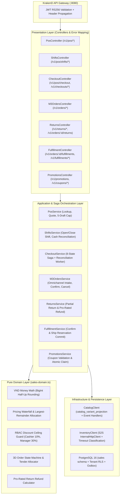

# M3 Sales & POS Microservice — Architecture Report

## 1. Bounded Context & Ownership Matrix

The **Sales (`apps/sales`)** microservice is the authoritative system of record for commercial order orchestration, Point-of-Sale (POS) register shifts, cart quoting, discount & coupon pricing waterfall, multi-tender payment allocation, order fulfillment orchestration, and sales returns.

| Bounded Context | Authoritative Owner | Integration Mechanism with Sales (`apps/sales`) |
|---|---|---|
| **Platform** (`apps/platform`) | Tenants, RBAC roles/permissions, branches | Event-driven `branch_projection` (`platform.branch.created`, `platform.branch.updated`) + JWT RS256 claims |
| **Catalog** (`apps/catalog`) | Product master data, variants, SKUs, barcodes, retail prices | Event-driven `catalog_variant_projection` (`catalog.variant.*`, `catalog.price.changed`, `catalog.product.deactivated`) + local indexed read lookup |
| **Inventory** (`apps/inventory`) | Warehouses, stock balances (`on_hand`, `reserved`, `available`), reservations, stock ledger | Synchronous S2S HTTP via `InventoryClient` (`/internal/inventory/reservations`, `/commit`, `/release`, `/returns/receive`) |
| **Sales** (`apps/sales`) | Orders, order items, tenders, status history, POS shifts, POS drafts, checkout saga, promotions, coupons, returns, fulfillments | Owns `sales` PostgreSQL schema (`14` tenant-isolated tables + `outbox_event` + `inbox_processed`) |
| **Customer** (`apps/customer`) | Customer profiles, loyalty tiers, debt limits | Validated by opaque `customer_id` UUID reference; consumes `sales.order.completed` |
| **Finance** (`apps/finance`) | Cashbook, payment settlement, AR/AP ledger | Consumes `sales.tender.recorded`, `sales.payment.confirmed`, `sales.refund.requested`, `sales.shift.closed` |
| **Integration** (`apps/integration`) | External marketplace connectors (Shopee, Lazada, TikTok Shop) | Submits normalized omnichannel orders to `POST /v1/orders` with `(sourceConnectionId, externalOrderId)` idempotency |
| **Insight** (`apps/insight`) | BI read models, daily revenue & product velocity | Consumes `sales.order.completed`, `sales.checkout.completed`, `sales.return.completed` |

---

## 2. Clean Layered Architecture inside `apps/sales`

---

## 3. Strict Cross-Service Boundary Enforcement

1. **Zero Cross-Schema SQL Joins or Foreign Keys:**
   - Every table in `apps/sales` resides strictly within the service-owned `sales` PostgreSQL schema.
   - Automated architecture test [`sales-architecture.spec.ts`](file:///Users/mac/Desktop/SEM7/pbl6/pbl-api/apps/sales/src/sales-architecture.spec.ts) scans all TypeScript files in `apps/sales/src` and asserts zero imports from `apps/catalog`, `apps/inventory`, or `apps/platform` and zero cross-schema SQL references.
2. **No Remote HTTP Calls Inside Open Database Transactions:**
   - All calls to `InventoryClient` (`reserveWarehouseStock`, `commitWarehouseReservation`, `releaseWarehouseReservation`, `receiveReturnedStock`) execute **outside** PostgreSQL transactions.
   - `checkout_workflow` persists intermediate states (`RESERVING_STOCK`, `STOCK_RESERVED`, `AWAITING_PAYMENT`, `COMMITTING_STOCK`, `FINALIZING`, `RECOVERY_PENDING`, `CONFIRMED`, `CANCELLED`, `REJECTED`) in short, discrete local transactions before and after each S2S HTTP call.
3. **Defense-in-Depth Multi-Tenant Isolation:**
   - Every transaction executes `SELECT set_config('app.tenant_id', $1, true)` and every table in `sales` enforces PostgreSQL Row-Level Security (`ENABLE ROW LEVEL SECURITY` + `FORCE ROW LEVEL SECURITY`).
