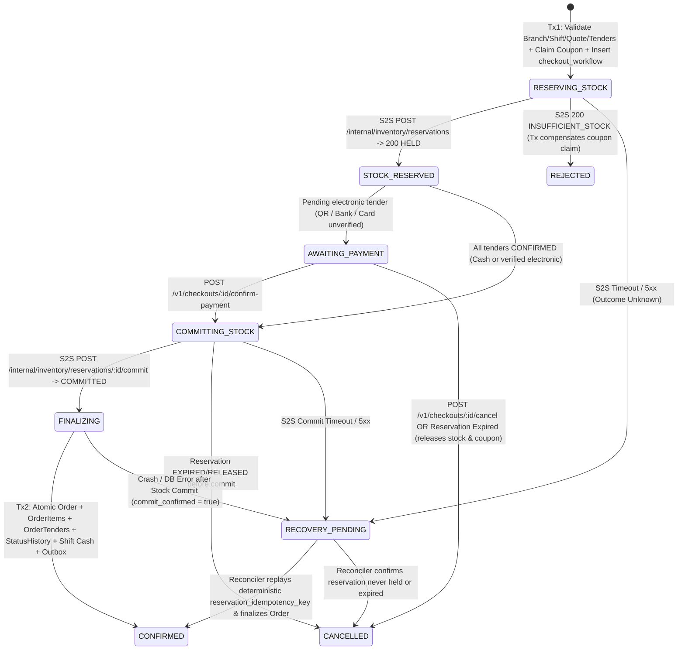

# M3 Sales & POS Microservice — Distributed Checkout Saga & Fault Recovery

## 1. Checkout Workflow State Machine (`checkout_workflow`)

Implemented in [`CheckoutService`](file:///Users/mac/Desktop/SEM7/pbl6/pbl-api/apps/sales/src/modules/checkout/checkout.service.ts) per [ADR-0012](file:///Users/mac/Desktop/SEM7/pbl6/pbl-api/docs/decisions/0012-sales-checkout-reservation-saga.md) and [ADR-0015](file:///Users/mac/Desktop/SEM7/pbl6/pbl-api/docs/decisions/0015-sales-m3-checkout-saga-pricing-and-pos.md).

---

## 2. Deterministic Idempotency Key Derivation

Every checkout workflow generates a deterministic Inventory reservation idempotency key:
$$\text{reservation\_idempotency\_key} = \text{SHA256}(\text{tenant\_id} + \text{":"} + \text{idempotency\_key} + \text{":reserve"})$$
and a deterministic `orderId` (`workflow.id`).

Because `reservation_idempotency_key` is persisted inside `checkout_workflow` **before** calling Inventory:
- Retrying after a network timeout (`503 CHECKOUT_RECOVERY_PENDING`) sends the **exact same `Idempotency-Key`** to Inventory.
- Inventory's `UQ_reservations_tenant_idempotency` returns the existing `HELD` or `COMMITTED` reservation (`replayed: true`) instead of deducting stock twice.

---

## 3. Fault-Injection Scenarios & Verified Recovery Behavior

| Fault Scenario | Injected Failure Point | System Behavior | Verified In `sales.int-spec.ts` |
|---|---|---|---|
| **Fault K: Reserve Timeout** | `InventoryClient.reserveWarehouseStock` throws `503 ServiceUnavailableException` | `checkout_workflow` transitions to `RECOVERY_PENDING`. Calling `recoverCheckout(id)` replays `reserveWarehouseStock` with the same `reservation_idempotency_key`, commits stock, and creates 1 order. | `Test K` (`PASSED`) |
| **Fault L: Crash After Reserve** | `simulateFailureAfterReserve: true` throws after `STOCK_RESERVED` before commit | `checkout_workflow` saved as `RECOVERY_PENDING` with `reservationId`. Reconciler inspects reservation (`HELD`), commits it, and finalizes the order without re-reserving. | `Test L` (`PASSED`) |
| **Fault M: Crash After Commit** | `simulateFailureAfterCommit: true` throws after Inventory `COMMITTED` before local `orders` insert | `checkout_workflow` saved as `RECOVERY_PENDING` with `commitConfirmed = true`. Background reconciler `reconcilePendingWorkflows()` skips re-committing Inventory and atomically writes `orders`, `order_items`, `order_tenders`, and `outbox_event`. | `Test M` (`PASSED`) |
| **Shortage Compensation** | Inventory returns `INSUFFICIENT_STOCK` on a checkout that claimed a limited coupon | Compensating transaction decrements `coupons.used_count`, deletes `coupon_usages`, and marks `checkout_workflow.state = 'REJECTED'`. | `Test A & H` (`PASSED`) |
