# M3 Sales & POS Microservice — Entity-Relationship Diagram (ERD)

## 1. PostgreSQL `sales` Schema Overview

All 14 domain tables + 2 event infrastructure tables (`outbox_event`, `inbox_processed`) reside inside the `sales` schema with `ENABLE ROW LEVEL SECURITY` and `FORCE ROW LEVEL SECURITY` bound to `current_setting('app.tenant_id', true)`.

```mermaid
erDiagram
  orders ||--o{ order_items : "contains (tenant_id, order_id)"
  orders ||--o{ order_tenders : "settled by (tenant_id, order_id)"
  orders ||--o{ order_status_history : "audits (tenant_id, order_id)"
  orders ||--o{ sales_returns : "returned via (tenant_id, order_id)"
  orders ||--o{ order_fulfillments : "fulfilled via (tenant_id, order_id)"
  pos_shifts ||--o{ orders : "records POS orders (shift_id)"
  pos_shifts ||--o{ order_tenders : "collects cash (shift_id)"
  checkout_workflow ||--o| orders : "finalizes into (order_id)"
  sales_returns ||--o{ sales_return_items : "lines (tenant_id, return_id)"
  sales_returns ||--o{ refund_requests : "triggers (tenant_id, return_id)"
  order_fulfillments ||--o{ fulfillment_items : "ships (tenant_id, fulfillment_id)"
  promotions ||--o{ coupons : "issues (tenant_id, promotion_id)"
  coupons ||--o{ coupon_usages : "tracks claims (tenant_id, coupon_id)"

  orders {
    uuid id PK
    uuid tenant_id
    varchar code "UQ(tenant_id, code)"
    uuid branch_id
    uuid warehouse_id
    uuid shift_id
    uuid customer_id
    varchar channel_type "POS | MANUAL | MARKETPLACE | WEB"
    varchar source_connection_id
    varchar external_order_id "UQ(tenant_id, source_connection_id, external_order_id)"
    varchar order_status "DRAFT | PENDING | CONFIRMED | COMPLETED | CANCELLED"
    varchar payment_status "UNPAID | PARTIALLY_PAID | PAID | REFUND_PENDING | PARTIALLY_REFUNDED | REFUNDED"
    varchar fulfillment_status "UNFULFILLED | RESERVED | PARTIALLY_FULFILLED | FULFILLED | RETURNED"
    numeric subtotal
    numeric item_discount_total
    varchar order_discount_type
    numeric order_discount_value
    numeric order_discount_total
    numeric promotion_discount_total
    varchar coupon_code
    numeric shipping_fee
    numeric tax_total
    numeric grand_total
    numeric paid_amount
    numeric refunded_amount
    uuid reservation_id
    int version
    timestamptz created_at
    timestamptz completed_at
  }

  order_items {
    uuid id PK
    uuid tenant_id
    uuid order_id FK
    uuid variant_id
    uuid product_id
    varchar sku
    varchar name
    varchar variant_label
    varchar unit_code
    numeric conversion_factor
    numeric qty
    numeric base_qty
    bigint unit_price
    numeric line_gross
    varchar item_discount_type
    numeric item_discount_value
    numeric item_discount_amount
    numeric allocated_order_discount
    numeric line_net
    numeric tax_rate
    numeric tax_amount
    bigint line_total
    numeric unit_cost_snapshot
    numeric returned_qty
    numeric refunded_amount
  }

  checkout_workflow {
    uuid id PK
    uuid tenant_id
    varchar idempotency_key "UQ(tenant_id, idempotency_key)"
    varchar request_sha256
    varchar reservation_idempotency_key
    varchar state "RESERVING_STOCK | STOCK_RESERVED | AWAITING_PAYMENT | COMMITTING_STOCK | FINALIZING | CONFIRMED | RECOVERY_PENDING | REJECTED | CANCELLED"
    uuid branch_id
    uuid warehouse_id
    uuid shift_id
    uuid draft_id
    uuid reservation_id
    uuid order_id
    boolean commit_confirmed
    int retry_count
    jsonb quote_json
    jsonb tenders_json
  }

  pos_shifts {
    uuid id PK
    uuid tenant_id
    varchar code "UQ(tenant_id, code)"
    uuid branch_id
    varchar register_code
    uuid staff_id
    varchar status "OPEN | CLOSED"
    numeric opening_cash
    numeric cash_sales_total
    numeric cash_refunds_total
    numeric expected_cash
    numeric actual_cash
    numeric variance
    timestamptz opened_at
    timestamptz closed_at
  }

  pos_drafts {
    uuid id PK
    uuid tenant_id
    uuid branch_id
    uuid staff_id
    varchar status "ACTIVE | CONVERTED | EXPIRED"
    jsonb lines_json
    timestamptz expires_at
  }

  order_tenders {
    uuid id PK
    uuid tenant_id
    uuid order_id FK
    uuid checkout_id
    uuid shift_id
    varchar idempotency_key "UQ(tenant_id, idempotency_key)"
    varchar method "CASH | BANK_TRANSFER | CARD | E_WALLET | COD"
    numeric amount
    numeric tendered_cash
    numeric change_due
    varchar status "PENDING | CONFIRMED | FAILED"
    varchar external_ref
  }

  sales_returns {
    uuid id PK
    uuid tenant_id
    varchar code "UQ(tenant_id, code)"
    uuid order_id FK
    uuid branch_id
    uuid warehouse_id
    uuid shift_id
    varchar status "REQUESTED | APPROVED | RECEIVED | COMPLETED | CANCELLED"
    numeric total_refund_amount
    uuid inventory_receipt_id
  }

  sales_return_items {
    uuid id PK
    uuid tenant_id
    uuid return_id FK
    uuid order_item_id FK
    uuid variant_id
    varchar sku_code
    numeric qty
    numeric base_qty
    numeric unit_refund_amount
    numeric line_refund_amount
  }

  refund_requests {
    uuid id PK
    uuid tenant_id
    uuid return_id FK
    uuid order_id FK
    varchar idempotency_key "UQ(tenant_id, idempotency_key)"
    varchar method "CASH | BANK_TRANSFER | CARD | E_WALLET"
    numeric amount
    varchar status "PENDING | COMPLETED"
  }

  order_fulfillments {
    uuid id PK
    uuid tenant_id
    varchar code "UQ(tenant_id, code)"
    uuid order_id FK
    uuid branch_id
    uuid warehouse_id
    uuid reservation_id
    varchar status "PENDING | CONFIRMED | SHIPPED | DELIVERED | COMPLETED | CANCELLED"
    varchar tracking_code
    varchar carrier_name
  }

  fulfillment_items {
    uuid id PK
    uuid tenant_id
    uuid fulfillment_id FK
    uuid order_item_id FK
    uuid variant_id
    varchar sku_code
    numeric qty
    numeric base_qty
  }

  promotions {
    uuid id PK
    uuid tenant_id
    varchar code "UQ(tenant_id, code)"
    varchar name
    varchar discount_type "FIXED | PERCENT"
    numeric discount_value
    numeric min_order_amount
    numeric max_discount_amount
    varchar status "ACTIVE | INACTIVE"
  }

  coupons {
    uuid id PK
    uuid tenant_id
    uuid promotion_id FK
    varchar code "UQ(tenant_id, code)"
    int max_uses
    int used_count
    int max_uses_per_customer
    varchar status "ACTIVE | INACTIVE"
  }

  coupon_usages {
    uuid id PK
    uuid tenant_id
    uuid coupon_id FK
    uuid order_id
    uuid customer_id
  }

  catalog_variant_projection {
    uuid id PK
    uuid tenant_id
    uuid variant_id "UQ(tenant_id, variant_id)"
    uuid product_id
    varchar sku_code
    varchar barcode
    varchar product_name
    varchar variant_name
    varchar unit_code
    numeric conversion_factor
    numeric unit_price
    varchar status "ACTIVE | INACTIVE | ARCHIVED"
    int aggregate_version
  }

  branch_projection {
    uuid branch_id PK
    uuid tenant_id
    varchar code
    varchar name
    boolean is_warehouse
    varchar status "active | inactive | deleted"
  }
```

---

## 2. Key Indexes & Database Constraints

| Table | Index / Constraint Name | Definition | Purpose |
|---|---|---|---|
| `catalog_variant_projection` | `UQ_catalog_variant_projection_tenant_variant` | `UNIQUE (tenant_id, variant_id)` | Upsert variant projections by `variantId` |
| `catalog_variant_projection` | `IDX_catalog_variant_projection_barcode` | `(tenant_id, barcode) WHERE barcode IS NOT NULL` | Sub-millisecond POS barcode scanner lookup |
| `catalog_variant_projection` | `IDX_catalog_variant_projection_sku` | `(tenant_id, sku_code)` | Sub-millisecond POS SKU lookup |
| `checkout_workflow` | `UQ_checkout_workflow_tenant_idempotency` | `UNIQUE (tenant_id, idempotency_key)` | Atomic checkout idempotency & duplicate replay |
| `orders` | `UQ_orders_tenant_external` | `UNIQUE (tenant_id, source_connection_id, external_order_id) WHERE ... IS NOT NULL` | Marketplace / omnichannel order deduplication |
| `orders` | `IDX_orders_tenant_branch_created` | `(tenant_id, branch_id, created_at DESC)` | Fast paginated order list by branch |
| `order_items` | `IDX_order_items_tenant_order` | `(tenant_id, order_id)` | Fast order line items & return eligibility lookup |
| `pos_shifts` | `UQ_pos_shifts_active_staff_register` | `UNIQUE (tenant_id, branch_id, staff_id, register_code) WHERE status = 'OPEN'` | Prevents duplicate open POS shifts on same register |
| `coupons` | `CHK_coupons_usage_bounds` | `CHECK (used_count >= 0 AND (max_uses IS NULL OR used_count <= max_uses))` | Database-level guard against coupon over-redemption |
