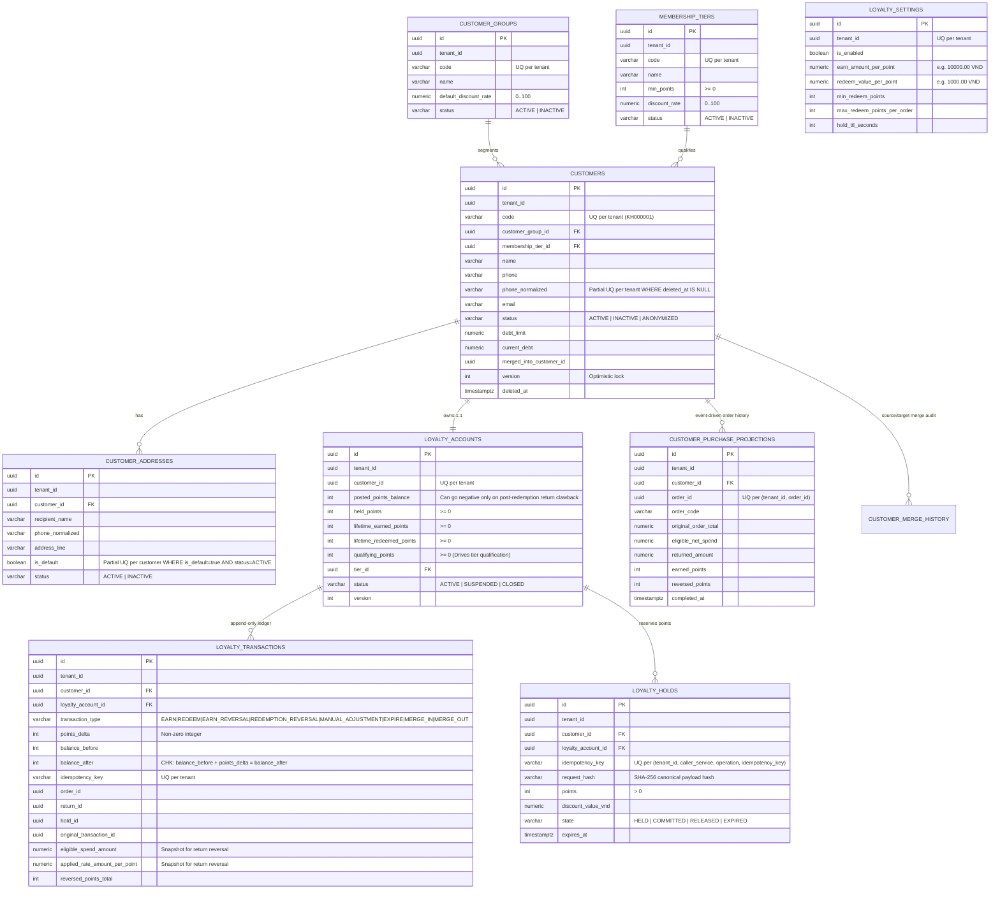

# M4 Customer & Loyalty Core — Entity-Relationship Diagram (ERD) & Schema Reference

## 1. Entity-Relationship Diagram

## 2. Database Constraints & Indexes Summary

| Table | Key Constraints & Indexes | Purpose |
|---|---|---|
| `customers` | `UQ_customers_tenant_code (tenant_id, code)` `UQ_customers_tenant_phone (tenant_id, phone_normalized) WHERE phone_normalized IS NOT NULL AND deleted_at IS NULL` `IDX_customers_tenant_created (tenant_id, created_at DESC, id DESC)` | Prevents duplicate active phone numbers per tenant; enables sub-millisecond POS phone lookup and keyset pagination |
| `customer_addresses` | `UQ_customer_addresses_single_default (tenant_id, customer_id) WHERE is_default = true AND status = 'ACTIVE'` | Database-enforced single active default address per customer |
| `loyalty_accounts` | `UQ_loyalty_accounts_customer (tenant_id, customer_id)` `CHK_loyalty_accounts_non_negative (held_points >= 0 AND lifetime_earned_points >= 0 AND lifetime_redeemed_points >= 0 AND qualifying_points >= 0)` | 1:1 wallet per customer with non-negative hold and lifetime counters |
| `loyalty_transactions` | `UQ_loyalty_tx_idempotency (tenant_id, idempotency_key)` `CHK_loyalty_tx_balance_math (points_delta <> 0 AND balance_after = balance_before + points_delta)` `IDX_loyalty_tx_customer_created (tenant_id, customer_id, created_at DESC)` | Immutable append-only ledger with strict arithmetic integrity and idempotent ingestion |
| `loyalty_holds` | `UQ_loyalty_holds_idempotency (tenant_id, caller_service, operation, idempotency_key)` `IDX_loyalty_holds_expiring (state, expires_at) WHERE state = 'HELD'` | Idempotent S2S point reservation and fast expiration sweep |
| `customer_purchase_projections` | `UQ_customer_purchase_proj_order (tenant_id, order_id)` `IDX_customer_purchase_proj_customer (tenant_id, customer_id, completed_at DESC)` | Idempotent order/return projection per order and fast customer order history pagination |
