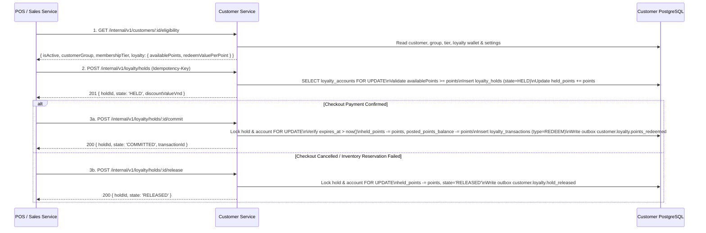

# M4 Customer & Loyalty — Sales & POS Integration Specification

## 1. Synchronous S2S Checkout Integration (Sales -> Customer)

## 2. Asynchronous Event-Driven Order & Return Integration

| Consumed Event | Producer | Customer Handler | Idempotency Guard | Domain Effect |
|---|---|---|---|---|
| `sales.order.completed` | `apps/sales` | `LoyaltyService.onSalesOrderCompleted` | `UQ_loyalty_tx_idempotency` (`earn:order:<orderId>`) + `UQ_customer_purchase_proj_order` | Upserts `customer_purchase_projections`, calculates earned points on net merchandise spend (`subtotal - discountTotal`), credits `posted_points_balance` & `qualifying_points`, upgrades membership tier if threshold reached, and reconciles any deferred out-of-order returns |
| `sales.checkout.completed` | `apps/sales` | `LoyaltyService.onSalesCheckoutCompleted` | Same (`earn:order:<orderId>`) | Shares the same idempotent `processCompletedSale` pipeline so even if both `sales.order.completed` and `sales.checkout.completed` fire for the same POS order, points are awarded **once** |
| `sales.return.completed` | `apps/sales` | `LoyaltyService.onSalesReturnCompleted` | `UQ_loyalty_tx_idempotency` (`earn_reversal:return:<returnId>`) | Computes pro-rated point reversal using the original `EARN` transaction snapshot (`eligible_spend_amount` & `applied_rate_amount_per_point`), inserts `EARN_REVERSAL` ledger entry, updates `customer_purchase_projections.returned_amount` & `reversed_points`, and re-evaluates tier |
