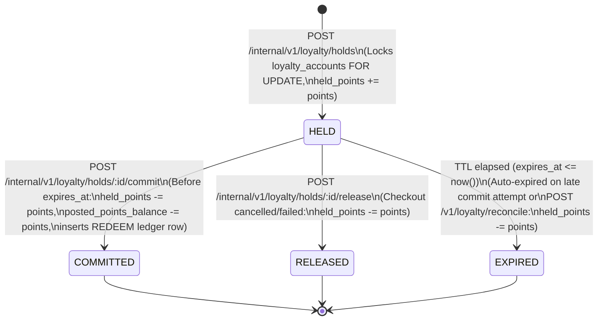

# M4 Loyalty Point Hold & Ledger State Machine

## 1. Loyalty Hold State Machine (`loyalty_holds`)

## 2. State Transition Rules & Conflict Matrix

| Current Hold State | Requested Operation | Outcome | Wallet & Ledger Effect |
|---|---|---|---|
| `(None)` | `createHold` (`Idempotency-Key` new) | `201 HELD` | `held_points += points`; `available_points` decreases |
| `HELD` / `COMMITTED` / `RELEASED` | `createHold` (same `Idempotency-Key` + identical `request_hash`) | `200` (`replayed: true`) | Zero duplicate mutation |
| `HELD` / `COMMITTED` / `RELEASED` | `createHold` (same `Idempotency-Key` + different `request_hash`) | `409 IDEMPOTENCY_CONFLICT` | Rejected |
| `HELD` (`expires_at > now()`) | `commitHold` | `200 COMMITTED` (`replayed: false`) | `held_points -= points`, `posted_points_balance -= points`, `lifetime_redeemed_points += points`, inserts `REDEEM` row |
| `COMMITTED` | `commitHold` (replay) | `200 COMMITTED` (`replayed: true`) | Idempotent no-op |
| `RELEASED` | `commitHold` | `409 LOYALTY_STATE_CONFLICT` | Rejected |
| `HELD` (`expires_at <= now()`) | `commitHold` | `409 LOYALTY_HOLD_EXPIRED` | Transitions hold to `EXPIRED`, `held_points -= points`, rejects commit |
| `HELD` | `releaseHold` | `200 RELEASED` (`replayed: false`) | `held_points -= points` |
| `RELEASED` | `releaseHold` (replay) | `200 RELEASED` (`replayed: true`) | Idempotent no-op |
| `COMMITTED` | `releaseHold` | `409 LOYALTY_HOLD_ALREADY_COMMITTED` | Rejected (committed redemptions can only be reversed via return/adjustment) |

## 3. Immutable Ledger Transaction Types (`loyalty_transactions`)

| Transaction Type | `points_delta` Sign | `posted_points_balance` Effect | `qualifying_points` Effect | Trigger |
|---|---|---|---|---|
| `EARN` | `+` (`> 0`) | Increases | Increases (triggers tier upgrade check) | `sales.order.completed` / `sales.checkout.completed` |
| `REDEEM` | `-` (`< 0`) | Decreases | Unchanged (never downgrades tier) | `POST /internal/v1/loyalty/holds/:id/commit` |
| `EARN_REVERSAL` | `-` (`< 0`) | Decreases (may go `< 0` under clawback policy) | Decreases (`GREATEST(0, ...)`) | `sales.return.completed` |
| `REDEMPTION_REVERSAL` | `+` (`> 0`) | Increases | Unchanged | Cancelled/reversed redemption |
| `MANUAL_ADJUSTMENT` | `+` or `-` (`<> 0`) | Increases or decreases (`>= 0` floor for manual debit) | Increases if `+` | `POST /v1/customers/:id/loyalty/adjustments` |
| `EXPIRE` | `-` (`< 0`) | Decreases | Unchanged | Point expiration policy |
| `MERGE_OUT` | `-` (`<> 0`) | Resets source wallet to `0` | Resets source `qualifying_points` to `0` | `POST /v1/customers/merge` (source customer) |
| `MERGE_IN` | `+` (`<> 0`) | Adds source balance to target wallet | Adds source `qualifying_points` to target | `POST /v1/customers/merge` (target customer) |
