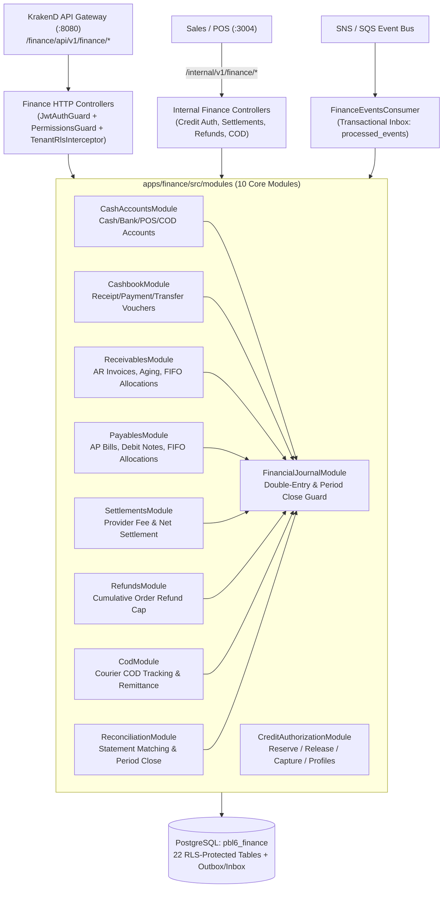

# M5 Finance Microservice — Architecture & Service Ownership

**Service:** `apps/finance` (`:3006`)  
**Database:** `pbl6_finance` (Dedicated PostgreSQL instance with Row-Level Security)  
**Architecture Decision Record:** [0017-finance-m5-journal-receivables-payables-credit-and-reconciliation.md](file:///Users/mac/Desktop/SEM7/pbl6/pbl-api/docs/decisions/0017-finance-m5-journal-receivables-payables-credit-and-reconciliation.md)

---

## 1. Bounded Context & Strict Service Ownership

`apps/finance` is the single system of record for money movements, double-entry operational subledgers, cashbooks, customer receivables, supplier payables, payment settlements, refunds, COD courier settlements, and reconciliation workflows.

| Domain Capability | Authoritative Owner | Non-Owners (Must Not Mutate Directly) |
|---|---|---|
| Operational Financial Journal (`financial_journal_entries`, `financial_journal_lines`) | `apps/finance` | `Sales`, `Inventory`, `Customer`, `Integration` |
| Cash & Bank Accounts (`cash_accounts`, `cash_account_balances`, `cashbook_entries`) | `apps/finance` | `Sales`, `Platform` |
| Customer Credit Limits & Holds (`customer_credit_profiles`, `customer_credit_holds`) | `apps/finance` | `Customer` (syncs policy ceiling via events), `Sales` (requests holds via internal API) |
| Customer Accounts Receivable (`customer_receivables`, `customer_debt_ledger`, `receivable_payments`, `receivable_payment_allocations`) | `apps/finance` | `Sales`, `Customer` |
| Supplier Accounts Payable (`supplier_payables`, `supplier_debt_ledger`, `payable_payments`, `payable_payment_allocations`) | `apps/finance` | `Inventory` |
| Payment Settlements (`payment_settlements`, `payment_settlement_allocations`, `payment_settlement_attempts`) | `apps/finance` | `Sales`, `Integration` |
| Financial Refunds (`refund_records`, `refund_execution_attempts`) | `apps/finance` | `Sales` (approves return, triggers Finance via event/internal API) |
| COD Receivables & Remittances (`cod_receivables`, `cod_remittance_batches`, `cod_remittance_items`) | `apps/finance` | `Sales`, `Integration` |
| Reconciliation & Period Closes (`reconciliation_batches`, `reconciliation_items`, `financial_period_closes`) | `apps/finance` | All other services |

---

## 2. Internal Modular Architecture

---

## 3. Multi-Tenant Isolation & Security Defense-in-Depth

1. **PostgreSQL Row-Level Security (RLS):**
   - Every one of the 22 M5 Finance tables has `ENABLE ROW LEVEL SECURITY` and `FORCE ROW LEVEL SECURITY`.
   - Tenant isolation policy `tenant_isolation_policy` enforces `tenant_id = current_setting('app.current_tenant', true)::uuid`.
   - Background worker / event consumer operations use `withTenantContext(dataSource, tenantId, async (em) => ...)` to bind `SET LOCAL app.current_tenant` inside the database transaction.
2. **Database-Enforced Journal Immutability:**
   - PostgreSQL trigger `trg_prevent_posted_journal_mutation` on `financial_journal_entries` and `trg_prevent_journal_line_mutation` on `financial_journal_lines` raise a hard exception if any code or SQL query attempts to `DELETE` a journal row or modify a `POSTED` entry (except transitioning `status` to `REVERSED` with `reversed_by_entry_id`).
3. **Granular RBAC Permissions:**
   - Enforced at controller level via `@RequirePermissions(...)`:
     - `finance.cashbook.read`, `finance.cashbook.create`, `finance.cashbook.cancel`
     - `finance.receivables.read`, `finance.receivables.collect`, `finance.credit.manage`
     - `finance.payables.read`, `finance.payables.pay`
     - `finance.refunds.execute`
     - `finance.reconciliation.manage`
     - `finance.reports.read`, `finance.period.close`
4. **Gateway Boundary Protection:**
   - Public routes `/finance/api/v1/finance/*` are exposed through KrakenD with RS256 JWKS validation and header propagation (`X-Tenant-Id`, `X-User-Id`, `X-Branch-Id`).
   - Internal service-to-service routes `/internal/v1/finance/*` are never exposed on KrakenD.
