# M5 Finance Microservice — Entity Relationship Diagram & Schema Reference

**Migration:** [`1791900000200-create-m5-finance-core.ts`](file:///Users/mac/Desktop/SEM7/pbl6/pbl-api/apps/finance/src/migrations/1791900000200-create-m5-finance-core.ts)  
**Entities:** [`finance.entities.ts`](file:///Users/mac/Desktop/SEM7/pbl6/pbl-api/apps/finance/src/entities/finance.entities.ts)

---

## 1. Entity Relationship Diagram (22 Domain Tables)

```mermaid
erDiagram
    FINANCIAL_JOURNAL_ENTRIES ||--|{ FINANCIAL_JOURNAL_LINES : "contains balanced lines"
    FINANCIAL_JOURNAL_ENTRIES ||--o| FINANCIAL_JOURNAL_ENTRIES : "reverses (reversed_by_entry_id)"

    CASH_ACCOUNTS ||--|| CASH_ACCOUNT_BALANCES : "tracks current balance"
    CASH_ACCOUNTS ||--o{ CASHBOOK_ENTRIES : "records inflows/outflows"
    CASHBOOK_ENTRIES }o--o| FINANCIAL_JOURNAL_ENTRIES : "posts journal_entry_id"
    CASHBOOK_ENTRIES }o--o| CASHBOOK_ENTRIES : "reversed by"

    CUSTOMER_CREDIT_PROFILES ||--o{ CUSTOMER_CREDIT_HOLDS : "authorizes holds"
    CUSTOMER_RECEIVABLES ||--o{ CUSTOMER_DEBT_LEDGER : "appends immutable entries"
    CUSTOMER_RECEIVABLES ||--o{ RECEIVABLE_PAYMENT_ALLOCATIONS : "settled by"
    RECEIVABLE_PAYMENTS ||--|{ RECEIVABLE_PAYMENT_ALLOCATIONS : "allocates across invoices"

    SUPPLIER_PAYABLES ||--o{ SUPPLIER_DEBT_LEDGER : "appends immutable entries"
    SUPPLIER_PAYABLES ||--o{ PAYABLE_PAYMENT_ALLOCATIONS : "settled by"
    PAYABLE_PAYMENTS ||--|{ PAYABLE_PAYMENT_ALLOCATIONS : "allocates across bills"

    PAYMENT_SETTLEMENTS ||--o{ PAYMENT_SETTLEMENT_ALLOCATIONS : "allocates to orders/AR"
    PAYMENT_SETTLEMENTS ||--o{ PAYMENT_SETTLEMENT_ATTEMPTS : "logs gateway callbacks"

    REFUND_RECORDS ||--o{ REFUND_EXECUTION_ATTEMPTS : "tracks provider execution"

    COD_REMITTANCE_BATCHES ||--|{ COD_REMITTANCE_ITEMS : "reconciles"
    COD_RECEIVABLES ||--o{ COD_REMITTANCE_ITEMS : "matched by tracking_number"

    RECONCILIATION_BATCHES ||--|{ RECONCILIATION_ITEMS : "matches statement lines"
```

---

## 2. Complete Table Catalog & Constraints

| # | Table Name | Primary Purpose | Key Uniqueness & Check Constraints |
|---|---|---|---|
| 1 | `financial_journal_entries` | Immutable double-entry header | `UQ(tenant_id, entry_code)`, `UQ(tenant_id, idempotency_key)`, `CHK(total_debit = total_credit)` |
| 2 | `financial_journal_lines` | Debit/credit lines per journal entry | `CHK((debit_amount > 0 AND credit_amount = 0) OR (credit_amount > 0 AND debit_amount = 0))` |
| 3 | `cash_accounts` | Cash drawers, bank accounts, POS clearing, COD clearing | `UQ(tenant_id, account_code)` |
| 4 | `cash_account_balances` | Materialized balance with optimistic `version` | `PK(cash_account_id)`, `FK(cash_account_id)` |
| 5 | `cashbook_entries` | Receipt, payment & transfer vouchers | `UQ(tenant_id, voucher_code)`, `UQ(tenant_id, idempotency_key)`, `CHK(amount > 0)` |
| 6 | `customer_credit_profiles` | Credit limit, current debt, held credit | `UQ(tenant_id, customer_id)`, `CHK(credit_limit >= 0 AND current_debt >= 0 AND held_credit >= 0)` |
| 7 | `customer_credit_holds` | Concurrency-safe credit reservations | `UQ(tenant_id, idempotency_key)`, `CHK(amount > 0)` |
| 8 | `customer_receivables` | AR invoices from credit orders | `UQ(tenant_id, receivable_code)`, `UQ(tenant_id, idempotency_key)`, `CHK(outstanding_amount >= 0)` |
| 9 | `customer_debt_ledger` | Append-only customer debt statement log | `UQ(tenant_id, idempotency_key)`, `IDX(tenant_id, customer_id, occurred_at DESC)` |
| 10 | `receivable_payments` | Customer debt collection header | `UQ(tenant_id, payment_code)`, `UQ(tenant_id, idempotency_key)` |
| 11 | `receivable_payment_allocations` | Maps customer payment to specific AR invoices | `CHK(allocated_amount > 0)` |
| 12 | `supplier_payables` | AP bills from goods receipts | `UQ(tenant_id, payable_code)`, `UQ(tenant_id, idempotency_key)`, `CHK(outstanding_amount >= 0)` |
| 13 | `supplier_debt_ledger` | Append-only supplier debt statement log | `UQ(tenant_id, idempotency_key)`, `IDX(tenant_id, supplier_id, occurred_at DESC)` |
| 14 | `payable_payments` | Supplier payout header | `UQ(tenant_id, payment_code)`, `UQ(tenant_id, idempotency_key)` |
| 15 | `payable_payment_allocations` | Maps supplier payout to specific AP bills | `CHK(allocated_amount > 0)` |
| 16 | `payment_settlements` | Gross, provider fee, and net settlement records | `UQ(tenant_id, settlement_code)`, `UQ(tenant_id, idempotency_key)`, `CHK(net_amount = gross_amount - fee_amount)` |
| 17 | `payment_settlement_allocations` | Links settlement to order/receivable | `CHK(allocated_amount > 0)` |
| 18 | `payment_settlement_attempts` | Audit log of gateway settlement attempts | `IDX(tenant_id, settlement_id)` |
| 19 | `refund_records` | Financial refund with order cap enforcement | `UQ(tenant_id, refund_code)`, `UQ(tenant_id, idempotency_key)`, `CHK(amount > 0)` |
| 20 | `refund_execution_attempts` | Audit log of provider/cash refund executions | `IDX(tenant_id, refund_id)` |
| 21 | `cod_receivables` | Courier COD tracking receivable | `UQ(tenant_id, tracking_number)`, `UQ(tenant_id, idempotency_key)` |
| 22 | `cod_remittance_batches` | Courier remittance statement header | `UQ(tenant_id, batch_code)`, `UQ(tenant_id, idempotency_key)` |
| 23 | `cod_remittance_items` | Per-shipment COD collection, fee, and discrepancy | `IDX(tenant_id, batch_id)` |
| 24 | `reconciliation_batches` | Bank/gateway reconciliation batch header | `UQ(tenant_id, batch_code)`, `UQ(tenant_id, idempotency_key)` |
| 25 | `reconciliation_items` | Matched/unmatched/discrepancy statement lines | `IDX(tenant_id, batch_id, status)` |
| 26 | `financial_period_closes` | Closed accounting periods blocking backdated posts | `UQ(tenant_id, branch_id, period_start, period_end)` |
