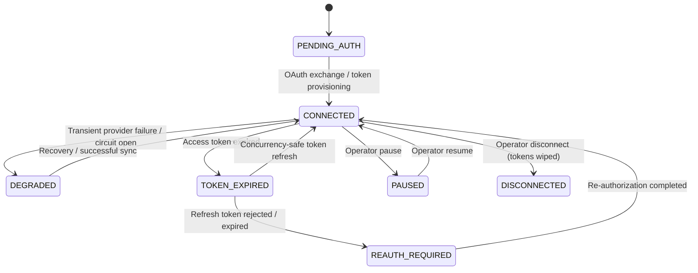

# M6 Channel Connection Security, OAuth State & Credential Encryption

## 1. Connection Lifecycle State Machine

Implemented in [`integration-domain.ts`](file:///Users/mac/Desktop/SEM7/pbl6/pbl-api/apps/integration/src/domain/integration-domain.ts) and [`connections.service.ts`](file:///Users/mac/Desktop/SEM7/pbl6/pbl-api/apps/integration/src/modules/connections/connections.service.ts).

## 2. AES-256-GCM Envelope Encryption at Rest

All marketplace secrets (`accessToken`, `refreshToken`, `webhookSecret`) are encrypted before persistence in `connection_credentials` using [`encryptCredentialSecret`](file:///Users/mac/Desktop/SEM7/pbl6/pbl-api/apps/integration/src/domain/integration-domain.ts#L171-L202):
- **Cipher:** `aes-256-gcm` with a random 96-bit (12-byte) IV and 128-bit (16-byte) authentication tag per encryption operation.
- **Format:** `v1:<ivB64>:<authTagB64>:<ciphertextB64>`.
- **Zero Plaintext Exposure:** API responses return [`SanitizedChannelConnectionView`](file:///Users/mac/Desktop/SEM7/pbl6/pbl-api/apps/integration/src/modules/connections/connections.service.ts#L35-L64) containing boolean indicators (`hasAccessToken`, `hasRefreshToken`) and expiration timestamps, never plaintext or ciphertext secrets.
- **Recursive Log Redaction:** [`redactSensitiveObject`](file:///Users/mac/Desktop/SEM7/pbl6/pbl-api/apps/integration/src/domain/integration-domain.ts#L228-L261) strips any key matching `token`, `secret`, `signature`, `authorization`, `password`, `app_key`, or `partner_key`.

## 3. Concurrency-Safe Token Refresh (Lease + CAS)

When multiple workers encounter an expiring token simultaneously (Mandatory Test H):
1. [`ConnectionsService.refreshCredentials`](file:///Users/mac/Desktop/SEM7/pbl6/pbl-api/apps/integration/src/modules/connections/connections.service.ts#L455-L625) acquires a transaction-scoped advisory lock `pg_advisory_xact_lock(hashtext(tenantId), hashtext('conn-refresh:' || connectionId))` and locks the `connection_credentials` row.
2. If another worker already refreshed the token (`credentialVersion > expectedCredentialVersion`), the follower returns `{ refreshed: false }` without calling the provider again.
3. The winning worker increments `credential_version = credential_version + 1` and stores the newly encrypted token pair atomically.
