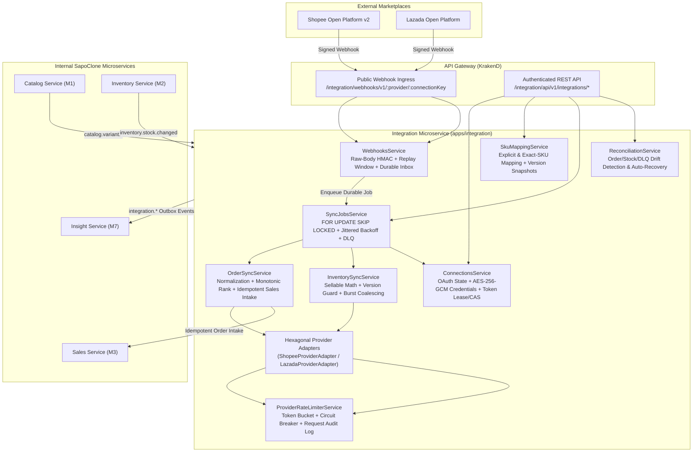

# M6 Integration Architecture — Hexagonal Omnichannel & Marketplace Core

## 1. Architectural Overview

The **Integration Microservice (`apps/integration`)** is the authoritative anti-corruption layer and omnichannel orchestrator between SapoClone's internal domain services (`Catalog`, `Inventory`, `Sales`, `Finance`, `Insight`) and external e-commerce marketplaces (**Shopee Open Platform v2** and **Lazada Open Platform**).

## 2. Strict Microservice Ownership Boundaries

| Boundary | Owned by Integration (`apps/integration`) | Never Owned / Mutated by Integration |
|---|---|---|
| **Marketplace Connections & Credentials** | `channel_connections`, `connection_credentials` (AES-256-GCM envelope encryption, token refresh leases, `credential_version` CAS) | Platform IAM accounts, employee roles, tenant subscriptions |
| **Webhook Ingress** | `webhook_inbox_events` (cryptographic verification, 5-minute replay window, idempotent deduplication) | Unverified direct mutations to Sales or Inventory |
| **SKU Mapping** | `sku_mappings`, `integration_catalog_variants` read projection | Master Catalog products/variants (`apps/catalog`) |
| **Omnichannel Order Sync** | `channel_order_refs` (external-to-internal order reference, monotonic status rank, immutable mapping snapshot) | Canonical `orders`, `order_lines`, or financial postings (`apps/sales`, `apps/finance`) |
| **Inventory Availability Publication** | `channel_inventory_publications`, `integration_stock_projections` read projection | Authoritative warehouse `stock_balances` or `stock_ledger` (`apps/inventory`) |
| **Background Jobs, Conflicts & Reconciliation** | `sync_jobs`, `sync_conflicts`, `integration_dead_letter_events`, `reconciliation_runs`, `reconciliation_issues` | Cross-service analytical data marts (`apps/insight`) |

## 3. Hexagonal Provider Abstraction

Provider-specific payloads, URLs, and cryptographic rules are strictly isolated behind [`MarketplaceProviderAdapter`](file:///Users/mac/Desktop/SEM7/pbl6/pbl-api/apps/integration/src/providers/contracts/provider.contracts.ts):
- [`ShopeeProviderAdapter`](file:///Users/mac/Desktop/SEM7/pbl6/pbl-api/apps/integration/src/providers/shopee/shopee.adapter.ts)
- [`LazadaProviderAdapter`](file:///Users/mac/Desktop/SEM7/pbl6/pbl-api/apps/integration/src/providers/lazada/lazada.adapter.ts)
- [`ProviderRegistryService`](file:///Users/mac/Desktop/SEM7/pbl6/pbl-api/apps/integration/src/providers/provider-registry.service.ts)
- Architectural boundary enforcement is verified automatically in [`integration-architecture.spec.ts`](file:///Users/mac/Desktop/SEM7/pbl6/pbl-api/apps/integration/src/integration-architecture.spec.ts).
