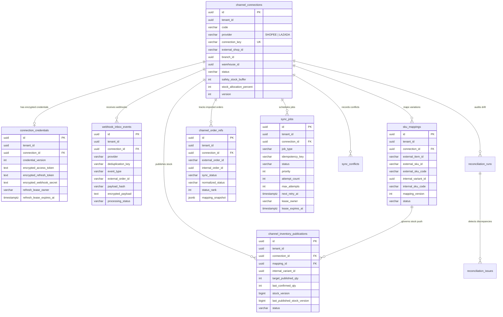

# M6 Integration ERD & PostgreSQL Schema Design

## 1. Entity-Relationship Diagram

Implemented in [`1791900000200-create-m6-integration-core.ts`](file:///Users/mac/Desktop/SEM7/pbl6/pbl-api/apps/integration/src/migrations/1791900000200-create-m6-integration-core.ts) and [`integration.entities.ts`](file:///Users/mac/Desktop/SEM7/pbl6/pbl-api/apps/integration/src/infrastructure/persistence/integration.entities.ts).

## 2. Row-Level Security (RLS) & Composite Uniqueness

All 15 domain and projection tables in [`1791900000200-create-m6-integration-core.ts`](file:///Users/mac/Desktop/SEM7/pbl6/pbl-api/apps/integration/src/migrations/1791900000200-create-m6-integration-core.ts) enforce PostgreSQL Row-Level Security (`ENABLE ROW LEVEL SECURITY` + `FORCE ROW LEVEL SECURITY`) via `enableTenantRlsPolicy`:
- Composite tenant foreign keys `FOREIGN KEY ("tenant_id", "connection_id") REFERENCES channel_connections ("tenant_id", "id")` make cross-tenant reference injection structurally impossible at the database level.
- Public webhook routing uses a dedicated `FOR SELECT` RLS policy (`webhook_routing_select_policy`) on `channel_connections` scoped to `current_setting('app.webhook_connection_key', true)`, after which `WebhooksService` immediately binds `app.tenant_id` from the verified connection row.
