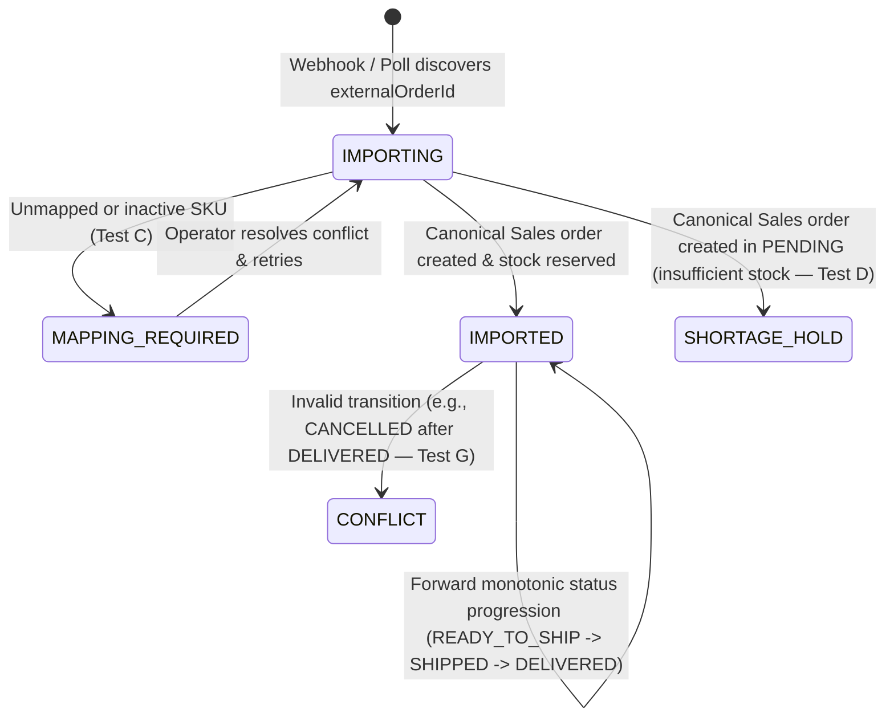

# M6 Omnichannel Order Synchronization Workflow

## 1. Order Import & Normalization State Machine

Implemented in [`order-sync.service.ts`](file:///Users/mac/Desktop/SEM7/pbl6/pbl-api/apps/integration/src/modules/order-sync/order-sync.service.ts) and [`sales-order.client.ts`](file:///Users/mac/Desktop/SEM7/pbl6/pbl-api/apps/integration/src/infrastructure/sales-client/sales-order.client.ts).

## 2. Key Engineering Guarantees

1. **Dual-Path Convergence (Test A & Test B):** Both webhook-driven import and incremental polling (`pollUpdatedOrdersForConnection`) acquire `pg_advisory_xact_lock(hashtext(tenantId), hashtext('ord-sync:' || connectionId || ':' || externalOrderId))` and enforce `UNIQUE (tenant_id, connection_id, external_order_id)` on `channel_order_refs`.
2. **Deterministic Upstream Sales Idempotency (Test S):** Calls to `SalesOrderClient.createOrRecoverOmnichannelOrder` carry deterministic idempotency key `omni-ord:${tenantId}:${connectionId}:${externalOrderId}`. If Integration crashes after Sales commits the canonical order, retry or reconciliation recovers the existing `internalOrderId` without creating a duplicate order.
3. **Unmapped SKU Quarantine (Test C):** If any order line lacks an `ACTIVE` SKU mapping, `OrderSyncService` records `ChannelOrderRefEntity` (`syncStatus = 'MAPPING_REQUIRED'`) and creates a `SyncConflictEntity` (`conflictType = 'SKU_UNMAPPED'`). No fake product variant or inventory reservation is ever fabricated.
4. **Insufficient Stock Handling (Test D):** If available stock is below ordered quantity, the canonical Sales order is created in `PENDING` (`SHORTAGE_HOLD`) with a `STOCK_INSUFFICIENT` conflict for operator action, never driving stock negative.
5. **Out-of-Order Status Protection (Test G):** [`evaluateOrderStatusProgression`](file:///Users/mac/Desktop/SEM7/pbl6/pbl-api/apps/integration/src/domain/integration-domain.ts#L417-L484) assigns monotonic status ranks (`UNPAID: 10`, `READY_TO_SHIP: 20`, `SHIPPED: 30`, `DELIVERED: 40`). Stale regressions (`READY_TO_SHIP` arriving after `SHIPPED`) return `IGNORE_STALE`, while contradictory transitions (`CANCELLED` after `DELIVERED`) create an `ORDER_STATE_CONFLICT`.
