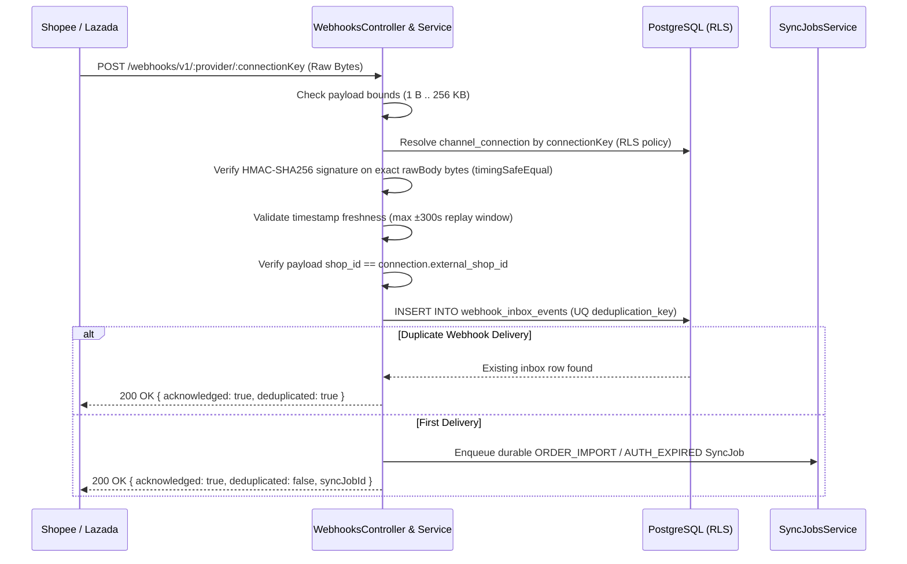

# M6 Secure Webhook Processing & Durable Inbox Architecture

## 1. End-to-End Webhook Ingress Pipeline

Implemented in [`webhooks.controller.ts`](file:///Users/mac/Desktop/SEM7/pbl6/pbl-api/apps/integration/src/modules/webhooks/webhooks.controller.ts) and [`webhooks.service.ts`](file:///Users/mac/Desktop/SEM7/pbl6/pbl-api/apps/integration/src/modules/webhooks/webhooks.service.ts).

## 2. Cryptographic Signature Verification & Replay Protection

- **Raw Body Preservation:** [`bootstrap-service.ts`](file:///Users/mac/Desktop/SEM7/pbl6/pbl-api/libs/common/src/bootstrap/bootstrap-service.ts) enables `rawBody: true` on the NestJS HTTP adapter so `req.rawBody` preserves exact wire bytes prior to JSON parsing.
- **Shopee v2 Signature:** `HMAC-SHA256(partnerKey, webhookUrl + "|" + rawBody)` verified via `crypto.timingSafeEqual` in [`verifyShopeeWebhookSignature`](file:///Users/mac/Desktop/SEM7/pbl6/pbl-api/apps/integration/src/domain/integration-domain.ts#L284-L307).
- **Lazada Signature:** `HMAC-SHA256(appSecret, rawBody)` verified via `crypto.timingSafeEqual` in [`verifyLazadaWebhookSignature`](file:///Users/mac/Desktop/SEM7/pbl6/pbl-api/apps/integration/src/domain/integration-domain.ts#L317-L338).
- **Replay Window:** [`assertWebhookTimestampFreshness`](file:///Users/mac/Desktop/SEM7/pbl6/pbl-api/apps/integration/src/domain/integration-domain.ts#L340-L361) rejects timestamps older than 300 seconds or more than 60 seconds in the future with `401 WEBHOOK_REPLAY_REJECTED`.
- **Persistence Failure Safety (Test F):** If durable database persistence fails, `WebhooksService` throws `503 WEBHOOK_PERSISTENCE_FAILED` and never returns a false `200 OK`.
