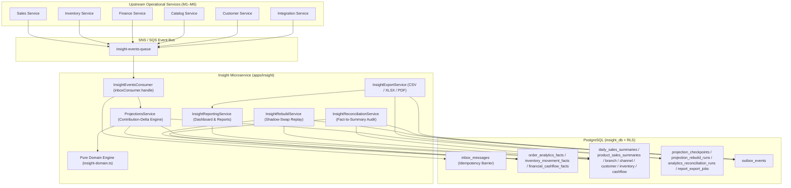

# M7 Insight & Analytics — Microservice Architecture (`M7_INSIGHT_ARCHITECTURE.md`)

**Date:** 2026-10-30
**Service:** `apps/insight` (`insight_db`)
**ADR Reference:** [0021-insight-m7-event-driven-projections-incremental-deltas-rebuild-and-reconciliation.md](file:///Users/mac/Desktop/SEM7/pbl6/pbl-api/docs/decisions/0021-insight-m7-event-driven-projections-incremental-deltas-rebuild-and-reconciliation.md)

---

## 1. Architectural Overview & Strict Microservice Ownership

The **Insight & Analytics Microservice (`apps/insight`)** is SapoClone's dedicated analytical read-model and reporting service. It adheres to strict Domain-Driven Design (DDD), Command Query Responsibility Segregation (CQRS), and Database-per-Service isolation:

- **Dedicated Database (`insight_db`):** Insight owns 18 PostgreSQL tables (2 M0 tables + 16 M7 analytical tables) inside `insight_db`.
- **Zero Cross-Database Queries:** Insight **never** joins or queries `sales_db`, `inventory_db`, `finance_db`, `catalog_db`, `customer_db`, or `integration_db`. All analytical projections are populated asynchronously via SNS/SQS domain events and retained local fact tables.
- **Zero Synchronous Operational Dependency:** Analytical queries (`/api/v1/insight/dashboard/*` and `/api/v1/insight/reports/*`) read exclusively from pre-aggregated projection tables in `insight_db`, ensuring POS checkout and order ingestion remain completely insulated from analytical workloads.
- **Row-Level Security (RLS) & Branch Authorization:** Every table in `insight_db` enforces PostgreSQL RLS (`tenant_isolation_policy` with `FORCE ROW LEVEL SECURITY` on `current_setting('app.current_tenant', true)::uuid`). Furthermore, `resolveAnalyticsAuthContext` ([`analytics-auth.helper.ts`](file:///Users/mac/Desktop/SEM7/pbl6/pbl-api/apps/insight/src/modules/analytics-auth.helper.ts)) enforces role-based permissions (`insight.*`) and branch-scope restrictions (`X-Branch-Ids`) before any SQL query executes.

---

## 2. Hexagonal / Layered Module Structure

### Key Code Modules

| Layer | File | Responsibility |
|---|---|---|
| **Domain Engine** | [`insight-domain.ts`](file:///Users/mac/Desktop/SEM7/pbl6/pbl-api/apps/insight/src/domain/insight-domain.ts) | Pure functions for scaled `bigint` decimal arithmetic, timezone calendar-day bucketing, `formatDateColumn`, contribution-delta computation, net sales/COGS/gross profit/margin/AOV/growth math, weighted-average unit cost, freshness evaluation, spreadsheet formula-injection sanitization, and CSV/XLSX/PDF generation. |
| **Persistence & RLS** | [`insight.entities.ts`](file:///Users/mac/Desktop/SEM7/pbl6/pbl-api/apps/insight/src/infrastructure/persistence/insight.entities.ts) & [`1791900000300-create-m7-insight-core.ts`](file:///Users/mac/Desktop/SEM7/pbl6/pbl-api/apps/insight/src/migrations/1791900000300-create-m7-insight-core.ts) | 17 TypeORM entities + PostgreSQL DDL migration creating 16 M7 tables, composite analytical indexes, `CHECK` constraints, and RLS policies. |
| **Event Consumer** | [`insight-events.consumer.ts`](file:///Users/mac/Desktop/SEM7/pbl6/pbl-api/apps/insight/src/consumers/insight-events.consumer.ts) | SQS listener wrapped in `@pbl/events` `InboxConsumer.handle` for atomic `(tenant_id, event_id)` deduplication. |
| **Projection Service** | [`projections.service.ts`](file:///Users/mac/Desktop/SEM7/pbl6/pbl-api/apps/insight/src/modules/projections/projections.service.ts) | Transactional incremental delta engine updating retained facts, dimensional caches, daily/product/category/branch/channel/customer/inventory/cashflow projections, and `projection_checkpoints`. |
| **Reporting Service** | [`insight-reporting.service.ts`](file:///Users/mac/Desktop/SEM7/pbl6/pbl-api/apps/insight/src/modules/reporting/insight-reporting.service.ts) | High-speed read queries for Executive Dashboard (overview, zero-filled revenue trend, top products, alerts) and 14 analytical reports. |
| **Rebuild Service** | [`insight-rebuild.service.ts`](file:///Users/mac/Desktop/SEM7/pbl6/pbl-api/apps/insight/src/modules/rebuild/insight-rebuild.service.ts) | Non-blocking shadow-swap projection rebuild engine replaying retained facts with deterministic SHA-256 checksum verification. |
| **Reconciliation Service** | [`insight-reconciliation.service.ts`](file:///Users/mac/Desktop/SEM7/pbl6/pbl-api/apps/insight/src/modules/reconciliation/insight-reconciliation.service.ts) | Automated fact-to-summary auditor across `SALES`, `INVENTORY`, `FINANCE`, and `GROSS_PROFIT` domains. |
| **Export Service** | [`insight-export.service.ts`](file:///Users/mac/Desktop/SEM7/pbl6/pbl-api/apps/insight/src/modules/export/insight-export.service.ts) | Deterministic CSV, XLSX, and PDF export pipeline with formula-injection protection and SHA-256 artifact checksums. |
| **HTTP Controllers** | [`insight-analytics.controller.ts`](file:///Users/mac/Desktop/SEM7/pbl6/pbl-api/apps/insight/src/modules/insight-analytics.controller.ts) & [`insight-internal.controller.ts`](file:///Users/mac/Desktop/SEM7/pbl6/pbl-api/apps/insight/src/modules/insight-internal.controller.ts) | 20 public `/api/v1/insight/*` endpoints and 6 internal `/internal/v1/insight/*` operational endpoints. |
