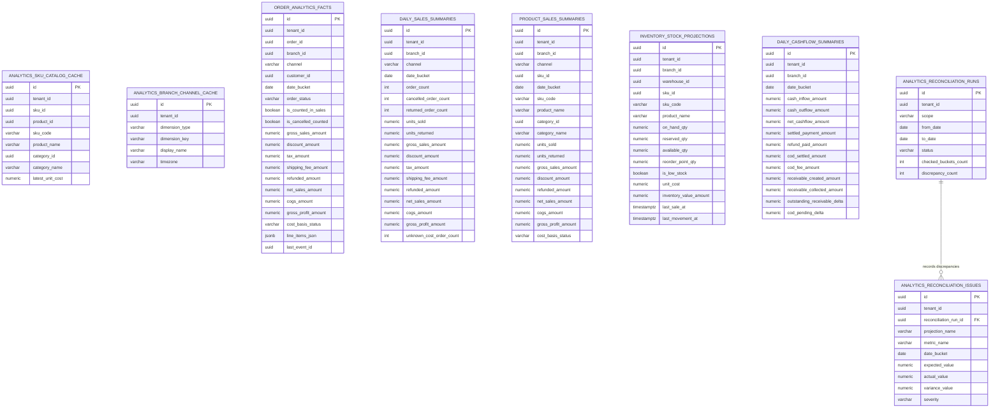

# M7 Insight & Analytics — Entity-Relationship Diagram & Schema Design (`M7_INSIGHT_ERD.md`)

**Date:** 2026-10-30
**Migration:** [`1791900000300-create-m7-insight-core.ts`](file:///Users/mac/Desktop/SEM7/pbl6/pbl-api/apps/insight/src/migrations/1791900000300-create-m7-insight-core.ts)
**Entities:** [`insight.entities.ts`](file:///Users/mac/Desktop/SEM7/pbl6/pbl-api/apps/insight/src/infrastructure/persistence/insight.entities.ts)

---

## 1. Analytical Data Model Overview

`insight_db` contains **18 domain tables** (plus `inbox_messages` and `outbox_events` from `@pbl/events`), organized into four logical tiers:

1. **Dimensional Lookup Cache Tier (2 tables):** Local event-hydrated caches of SKU/category metadata and branch/channel metadata so Insight never joins across microservices.
2. **Retained Fact & Contribution State Tier (3 tables):** Immutable/idempotent event-fact ledgers (`order_analytics_facts`, `inventory_movement_facts`, `financial_cashflow_facts`) that enable out-of-order convergence, late cancellations/returns, non-blocking shadow rebuilds, and automated reconciliation.
3. **Pre-Aggregated Analytical Summary Projections Tier (9 tables):** Indexed read models optimized for $< 10\text{ ms}$ dashboard and reporting queries (`daily_sales_summaries`, `daily_sales_projections`, `product_sales_summaries`, `category_sales_summaries`, `branch_sales_summaries`, `channel_sales_summaries`, `customer_sales_summaries`, `inventory_stock_projections`, `inventory_movement_summaries`, `daily_cashflow_summaries`).
4. **Operational Governance Tier (6 tables):** Audit logs, projection checkpoints, shadow rebuild runs, reconciliation runs + discrepancy issues, and report export jobs.

---

## 2. Entity-Relationship Diagram (Mermaid)

---

## 3. Composite Indexes & Query Optimization

All analytical summary tables use covering B-Tree composite indexes starting with `tenant_id` and `date_bucket` (or dimensional keys) so PostgreSQL executes `Index Scan` rather than sequential table scans:

- `UQ_daily_sales_summaries_key` on `(tenant_id, branch_id, channel, date_bucket)` + `IDX_daily_sales_summaries_tenant_date` on `(tenant_id, date_bucket)`.
- `UQ_product_sales_summaries_key` on `(tenant_id, branch_id, channel, sku_id, date_bucket)` + `IDX_product_sales_summaries_sku_date` on `(tenant_id, sku_id, date_bucket)`.
- `UQ_inventory_stock_projections_key` on `(tenant_id, warehouse_id, sku_id)` + `IDX_inventory_stock_projections_branch_sku` on `(tenant_id, branch_id, sku_id)` + `IDX_inventory_stock_projections_low_stock` on `(tenant_id, is_low_stock, branch_id)`.
- `UQ_daily_cashflow_summaries_key` on `(tenant_id, branch_id, date_bucket)` + `IDX_daily_cashflow_summaries_tenant_date` on `(tenant_id, date_bucket)`.
