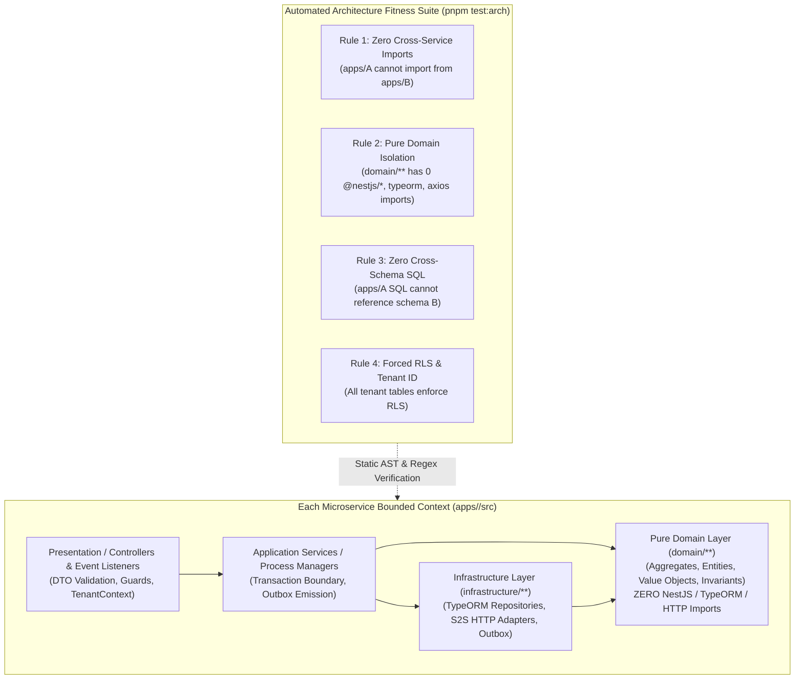

# M8 Architecture Compliance & Automated Fitness Gates

**Milestone:** M8 — Full-System Integration, Distributed Reliability & Architecture Validation

---

## 1. Hexagonal Bounded Context & CI Quality Gates (Diagram 12)

---

## 2. Architecture Fitness Test Execution Evidence

Executed via `pnpm test:arch` (and Phase 1 of `pnpm verify:m8`):

| Test Suite | File | Assertions Verified | Status |
|---|---|---|---|
| **Global DDD Fitness** | [`ddd-architecture-fitness.spec.ts`](file:///Users/mac/Desktop/SEM7/pbl6/pbl-api/libs/common/src/bootstrap/ddd-architecture-fitness.spec.ts) | Cross-service import ban, cross-schema SQL ban, domain purity across all 8 apps | **PASS** |
| **Platform Architecture** | [`platform-architecture.spec.ts`](file:///Users/mac/Desktop/SEM7/pbl6/pbl-api/apps/platform/src/platform-architecture.spec.ts) | `TenantAggregate`, `BranchAggregate`, `AccountAggregate` purity & boundary rules | **PASS** |
| **Catalog Architecture** | [`catalog-architecture.spec.ts`](file:///Users/mac/Desktop/SEM7/pbl6/pbl-api/apps/catalog/src/catalog-architecture.spec.ts) | `ProductAggregate`, `Barcode`, `SkuCode`, `Money` purity & schema isolation | **PASS** |
| **Inventory Architecture** | [`inventory-architecture.spec.ts`](file:///Users/mac/Desktop/SEM7/pbl6/pbl-api/apps/inventory/src/inventory-architecture.spec.ts) | `StockBalanceAggregate`, `ReservationAggregate`, `StockTransferAggregate` purity | **PASS** |
| **Sales Architecture** | [`sales-architecture.spec.ts`](file:///Users/mac/Desktop/SEM7/pbl6/pbl-api/apps/sales/src/sales-architecture.spec.ts) | `SalesOrderAggregate`, `SalesReturnAggregate`, S2S port/adapter separation | **PASS** |
| **Customer Architecture** | [`customer-architecture.spec.ts`](file:///Users/mac/Desktop/SEM7/pbl6/pbl-api/apps/customer/src/customer-architecture.spec.ts) | `CustomerProfileAggregate`, `LoyaltyAccountAggregate`, `VietnamesePhoneNumber` purity | **PASS** |
| **Finance Architecture** | [`finance-architecture.spec.ts`](file:///Users/mac/Desktop/SEM7/pbl6/pbl-api/apps/finance/src/finance-architecture.spec.ts) | `CustomerDebtAccountAggregate`, `CashbookEntryAggregate`, `RefundRecordAggregate` purity | **PASS** |
| **Integration Architecture** | [`integration-architecture.spec.ts`](file:///Users/mac/Desktop/SEM7/pbl6/pbl-api/apps/integration/src/integration-architecture.spec.ts) | `ChannelConnectionAggregate`, `OrderSyncRecordAggregate`, partner adapter isolation | **PASS** |
| **Insight Architecture** | [`insight-architecture.spec.ts`](file:///Users/mac/Desktop/SEM7/pbl6/pbl-api/apps/insight/src/insight-architecture.spec.ts) | Read-model isolation, zero direct writes to source schemas, `MetricMathDomain` purity | **PASS** |

**Total Architecture Fitness Suites:** `9 passed, 9 total` (`85 passed, 85 total` tests in `4.15s`).
