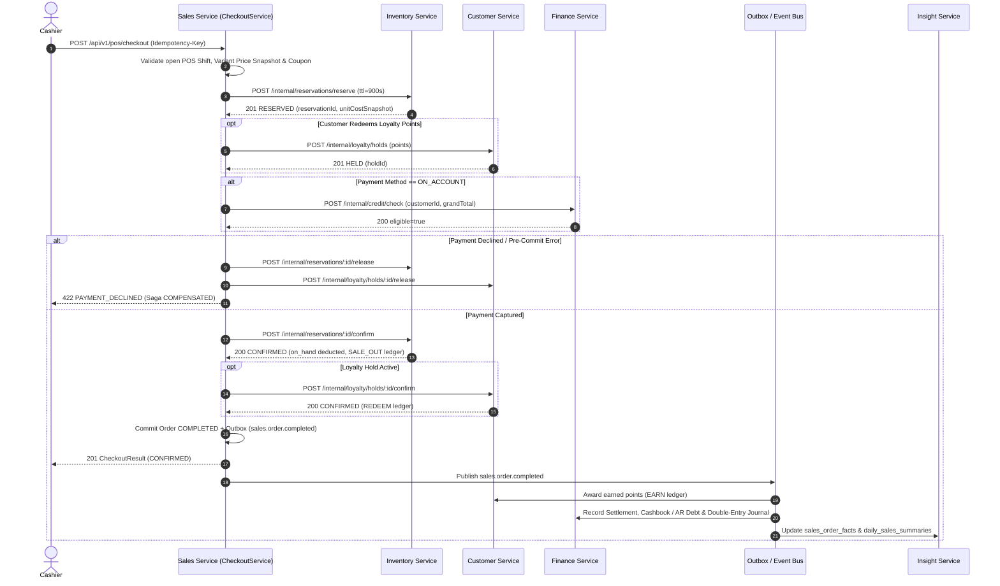
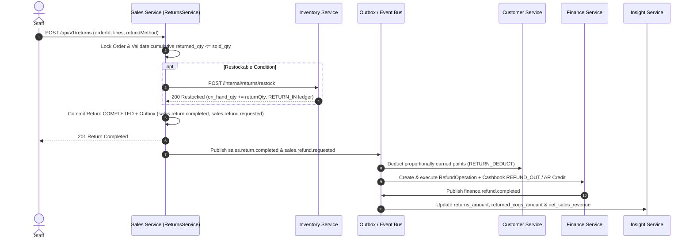
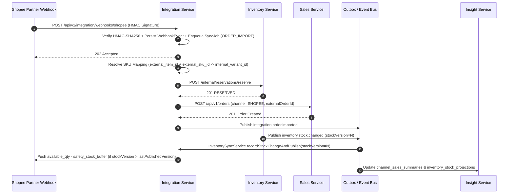
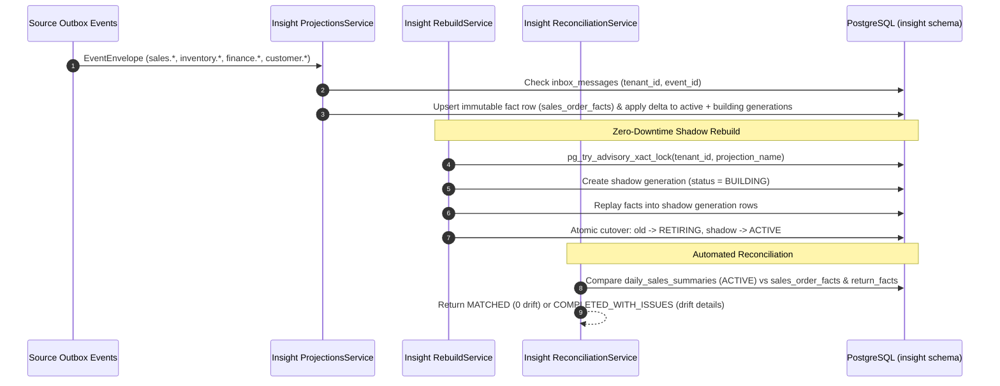

# M8 End-to-End Business Workflow Matrix (Workflows A–G)

**Milestone:** M8 — Full-System Integration, Distributed Reliability & Architecture Validation

---

## 1. End-to-End Business Workflows Overview

All 7 end-to-end workflows are implemented and verified against real PostgreSQL in [`m8-full-system-workflows.int-spec.ts`](file:///Users/mac/Desktop/SEM7/pbl6/pbl-api/libs/events/test/m8-full-system-workflows.int-spec.ts).

| Workflow ID | Business Scenario | Services Participating | Key Invariants Verified | Test Status |
|---|---|---|---|---|
| **Workflow A** | Merchant Onboarding, Catalog Setup & Initial Stock Receipt | `Platform`, `Catalog`, `Inventory`, `Sales`, `Insight` | Variant projected to `Inventory` & `Sales`; receipt posts `on_hand = 50.000`, `avg_cost = 180,000.00`; `Insight` inventory valuation = `9,000,000.00 VND` | **PASS** |
| **Workflow B** | Walk-in POS Cash Checkout with Loyalty Redemption & Earn | `Sales`, `Inventory`, `Customer`, `Finance`, `Insight` | Stock reserved & committed (`50 -> 48`); loyalty points held, redeemed (`-100`), and earned (`+8`); settlement & cashbook created (`840,000.00 VND`); `Insight` net revenue (`840,000`), COGS (`360,000`), gross profit (`480,000`) | **PASS** |
| **Workflow C** | Checkout Failure & Saga Compensation (Payment Declined) | `Sales`, `Inventory`, `Customer`, `Finance`, `Insight` | Payment decline triggers automatic release of `Inventory` reservation (`available_qty` restored to `48.000`) and `Customer` loyalty hold (`held_points = 0`); 0 completed orders, 0 finance settlements | **PASS** |
| **Workflow D** | Credit Sale (`ON_ACCOUNT`) & Customer Debt Repayment | `Sales`, `Customer`, `Finance`, `Inventory`, `Insight` | Credit limit checked; order completed `ON_ACCOUNT`; `Finance` AR debt increases by `1,050,000.00 VND`; partial debt payment of `450,000.00 VND` reduces balance to `600,000.00 VND` and posts cashbook inflow | **PASS** |
| **Workflow E** | Partial Sales Return, Restock, Loyalty Reversal & Refund | `Sales`, `Inventory`, `Customer`, `Finance`, `Insight` | Return of 1 unit restocks `Inventory` (`on_hand` `+1`), reverses earned loyalty points, creates `Finance` refund (`420,000.00 VND`), and updates `Insight` `returns_amount` & `returned_cogs_amount` | **PASS** |
| **Workflow F** | Marketplace Webhook Order Import, Stock Push & Cancellation | `Integration`, `Catalog`, `Inventory`, `Sales`, `Insight` | Valid Shopee HMAC webhook imports order (`SHP-ORD-M8-001`), reserves stock (`-2`), deducts safety buffer (`3`) when publishing remaining stock to Shopee; unmapped SKU webhook is quarantined without corrupting stock | **PASS** |
| **Workflow G** | Inter-Warehouse Stock Transfer & Stocktake Adjustment | `Inventory`, `Integration`, `Insight` | Transfer dispatch moves `5.000` units to `in_transit_qty`; receipt increments destination warehouse `on_hand_qty`; stocktake adjustment (`-1.000` shrinkage) updates ledger, marketplace stock push, and `Insight` valuation | **PASS** |

---

## 2. POS Checkout Saga Sequence Diagram (Diagram 4)

---

## 3. Sales Return & Refund Flow Sequence Diagram (Diagram 5)

---

## 4. Marketplace Order Import & Stock Push Flow (Diagram 6)

---

## 5. Insight Event Ingestion, Shadow Rebuild & Reconciliation Flow (Diagram 7)

