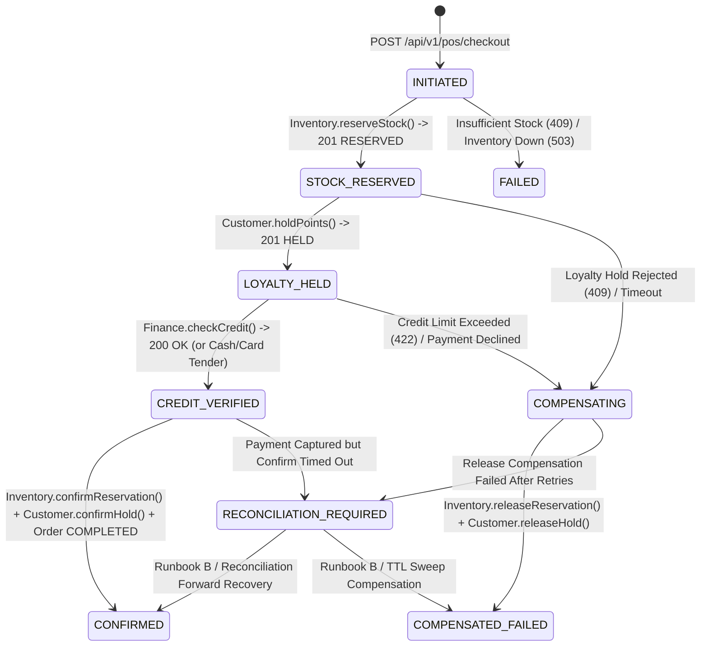

# M8 Distributed Saga & Process Manager Review

**Milestone:** M8 — Full-System Integration, Distributed Reliability & Architecture Validation

---

## 1. Checkout Process Manager State Machine (Diagram 8)

[`CheckoutService`](file:///Users/mac/Desktop/SEM7/pbl6/pbl-api/apps/sales/src/modules/checkout/checkout.service.ts) orchestrates the distributed checkout saga across `Sales`, `Inventory`, `Customer`, and `Finance` using durable state transitions persisted in `sales.checkout_sessions` / `sales.orders`.

---

## 2. Saga Step Inventory, Forward Actions & Compensations

| Step # | Saga Step | Forward Action | Idempotency Key | Compensating Action (Pre-Payment Failure) | Post-Payment Failure Policy |
|---|---|---|---|---|---|
| 1 | **Validate Shift, Catalog Price & Coupon** | Local DB read + `SELECT ... FOR UPDATE` on single-use coupon | `checkoutKey` | Local transaction rollback | N/A |
| 2 | **Reserve Inventory** | `InventoryClient.reserveStock` (`TTL = 15m`) | `chk-res:<checkoutKey>` | `InventoryClient.releaseReservation`; fallback to `ReservationsService.expireReservations` | Forward-confirm via `confirmReservation` |
| 3 | **Hold Loyalty Points** | `CustomerLoyaltyClient.holdPoints` | `chk-loy:<checkoutKey>` | `CustomerLoyaltyClient.releasePointsHold` | Forward-confirm via `confirmPointsHold` |
| 4 | **Verify Credit / Capture Payment** | `FinanceCreditClient.checkCredit` (for `ON_ACCOUNT`) or Tender Validation | `chk-pay:<checkoutKey>` | Release loyalty hold + release stock reservation | Pivot transaction boundary |
| 5 | **Confirm Stock & Loyalty + Commit Order** | `confirmReservation` + `confirmPointsHold` + commit `sales.orders` + emit `sales.order.completed` | `chk-cnf:<checkoutKey>` | N/A (past pivot) | Transition to `RECONCILIATION_REQUIRED` and alert via [Runbook B](file:///Users/mac/Desktop/SEM7/pbl6/pbl-api/docs/runbooks/RUNBOOK_B_CHECKOUT_RECONCILIATION_REQUIRED.md) |

---

## 3. Lost-Response Recovery Verification

In [`CheckoutService.reserveInventoryWithRecovery`](file:///Users/mac/Desktop/SEM7/pbl6/pbl-api/apps/sales/src/modules/checkout/checkout.service.ts), if `inventoryClient.reserveStock` creates a reservation in PostgreSQL (`inventory.stock_reservations`) and the HTTP response is lost due to a network timeout, `CheckoutService` immediately queries `inventoryClient.getWarehouseReservationByKey(warehouseId, reserveIdempotencyKey)`.
- **Verified in [`m8-concurrency-fault-reconciliation.int-spec.ts`](file:///Users/mac/Desktop/SEM7/pbl6/pbl-api/libs/events/test/m8-concurrency-fault-reconciliation.int-spec.ts) (Fault 2)**: The checkout recovers the existing `reservationId` deterministically in the same request and completes with `on_hand_qty` decremented exactly once (`20.000 -> 19.000`).
