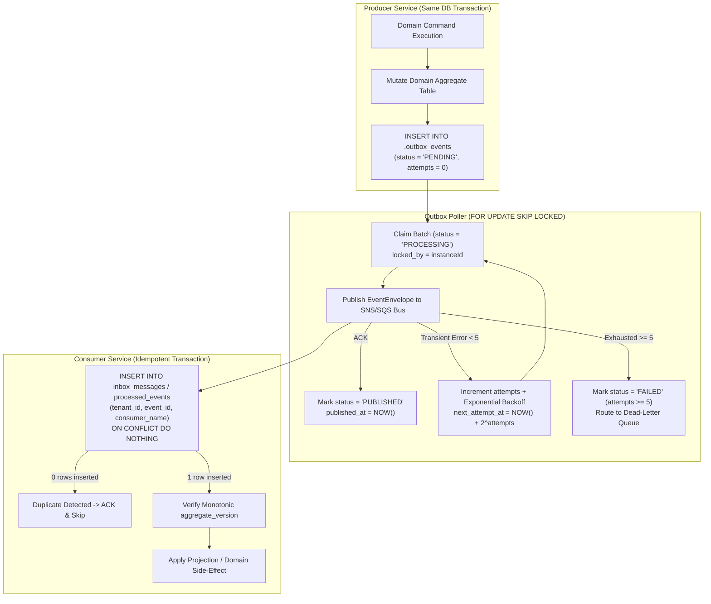

# M8 Transactional Outbox, Inbox Deduplication & DLQ Audit

**Milestone:** M8 — Full-System Integration, Distributed Reliability & Architecture Validation

---

## 1. Transactional Outbox, Inbox Deduplication & DLQ Recovery Lifecycle (Diagram 9)

---

## 2. Outbox & Inbox Schema Audit Across Services

| Service Schema | Outbox Table | Locking Strategy | Inbox / Deduplication Table | Dead-Letter Table / Mechanism |
|---|---|---|---|---|
| `catalog` | `catalog.outbox_events` | `FOR UPDATE SKIP LOCKED` | `catalog.processed_events` | `status = 'FAILED'` + `catalog-events-dlq` |
| `inventory` | `inventory.outbox_events` | `FOR UPDATE SKIP LOCKED` | `inventory.processed_events` | `status = 'FAILED'` + `inventory-events-dlq` |
| `sales` | `sales.outbox_events` | `FOR UPDATE SKIP LOCKED` | `sales.processed_events` | `status = 'FAILED'` + `sales-events-dlq` |
| `customer` | `customer.outbox_events` | `FOR UPDATE SKIP LOCKED` | `customer.processed_events` | `status = 'FAILED'` + `customer-events-dlq` |
| `finance` | `finance.outbox_events` | `FOR UPDATE SKIP LOCKED` | `finance.processed_events` | `status = 'FAILED'` + `finance-events-dlq` |
| `integration` | `integration.outbox_events` | `FOR UPDATE SKIP LOCKED` | `integration.inbox_events` | `integration.dead_letter_events` + `integration-events-dlq` |
| `insight` | `insight.outbox_events` | `FOR UPDATE SKIP LOCKED` | `insight.inbox_messages` | `insight.dead_letter_events` + `insight-events-dlq` |

---

## 3. Out-of-Order Event Protection

At-least-once delivery over SQS can deliver events out of order during retries. We verified three monotonic guards:
1. **`Catalog -> Sales` (`CatalogClient.onPriceChanged` & `upsertFromCatalogEvent`)**: Rejects updates where incoming `aggregate_version < existing.aggregate_version`.
2. **`Inventory -> Integration` (`InventorySyncService.recordStockChangeAndPublish`)**: Tracks `last_stock_version` per `(tenant_id, connection_id, internal_variant_id)` and marks stale stock events as `STALE_SKIPPED`.
3. **`Sales -> Insight` (`ProjectionsService.processSalesOrderEvent`)**: Computes idempotent contribution vectors (`OrderContributionVector`) against `sales_order_facts.last_aggregate_version` so late `sales.order.created` events cannot overwrite an already-projected `COMPLETED` order.
