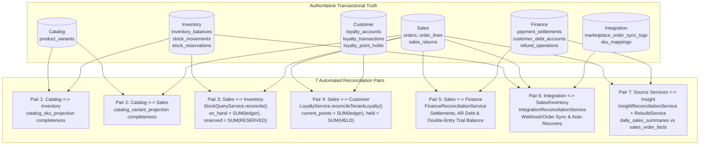

# M8 Cross-Service Reconciliation Design & Verification

**Milestone:** M8 — Full-System Integration, Distributed Reliability & Architecture Validation

---

## 1. Cross-Service Reconciliation & Self-Healing Architecture (Diagram 11)

---

## 2. The 7 Verified Reconciliation Pairs

All 7 reconciliation pairs are executed against real PostgreSQL in [`m8-concurrency-fault-reconciliation.int-spec.ts`](file:///Users/mac/Desktop/SEM7/pbl6/pbl-api/libs/events/test/m8-concurrency-fault-reconciliation.int-spec.ts) (lines 2017–2135):

| Pair # | Bounded Context Pair | Invariant Equation Verified | Clean Baseline Result | Injected Drift & Self-Healing Result |
|---|---|---|---|---|
| **Pair 1** | `Catalog` $\leftrightarrow$ `Inventory` | Every `ACTIVE` variant in `catalog.product_variants` exists in `inventory.catalog_sku_projection` | `missingInInv = 0` | Verified |
| **Pair 2** | `Catalog` $\leftrightarrow$ `Sales` | Every `ACTIVE` variant in `catalog.product_variants` exists in `sales.catalog_variant_projection` | `missingInSales = 0` | Verified |
| **Pair 3** | `Sales` $\leftrightarrow$ `Inventory` | `on_hand_qty = SUM(stock_movements.qty_delta)` AND `reserved_qty = SUM(stock_reservations.quantity WHERE status = 'RESERVED')` AND `available_qty = on_hand_qty - reserved_qty` | `mismatchesCount = 0` | Verified |
| **Pair 4** | `Sales` $\leftrightarrow$ `Customer` | `loyalty_accounts.current_points = SUM(loyalty_transactions.points_delta)` AND `held_points = SUM(loyalty_point_holds.points WHERE status = 'HELD')` | `discrepancyCount = 0` | Verified |
| **Pair 5** | `Sales` $\leftrightarrow$ `Finance` | Total `Debit = Credit` across double-entry journal lines; `customer_debt_accounts.current_balance = SUM(debt_ledger)`; settlements match completed orders | `FULL_SYSTEM` run completed | Verified |
| **Pair 6** | `Integration` $\leftrightarrow$ `Sales` / `Inventory` | Every imported marketplace order has a linked internal `Sales` order or explicit conflict status | `status = 'COMPLETED'` | Verified |
| **Pair 7** | `Source Services` $\leftrightarrow$ `Insight` | `daily_sales_summaries.net_sales_revenue = SUM(sales_order_facts.contributed_net_revenue) - SUM(sales_return_facts.net_refund_amount)` | `discrepanciesFound = 0` (`COMPLETED`) | Injected `+999,999.00 VND` drift $\rightarrow$ detected (`discrepanciesFound >= 1`, `COMPLETED_WITH_ISSUES`) $\rightarrow$ healed via `triggerRebuild` $\rightarrow$ `discrepanciesFound = 0` |
