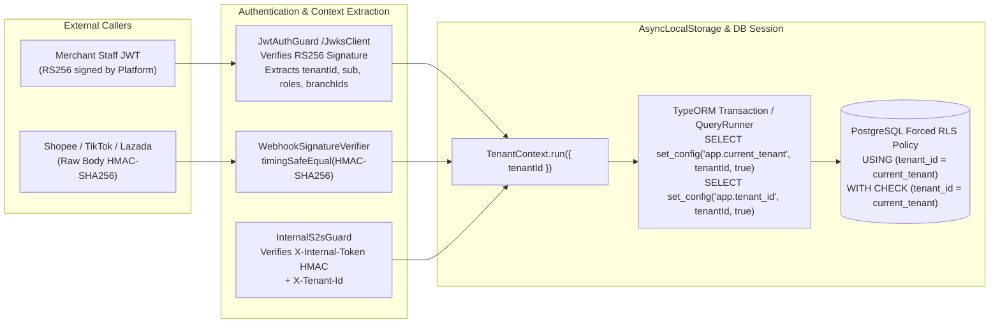

# M8 Security Baseline — Multi-Tenant RLS, JWT RS256, S2S Auth & Webhook HMAC

**Milestone:** M8 — Full-System Integration, Distributed Reliability & Architecture Validation

---

## 1. Multi-Tenant Auth, S2S Token & PostgreSQL RLS Isolation Boundary (Diagram 10)

---

## 2. Multi-Tenant Isolation Verification Results (Phase 7)

In [`m8-concurrency-fault-reconciliation.int-spec.ts`](file:///Users/mac/Desktop/SEM7/pbl6/pbl-api/libs/events/test/m8-concurrency-fault-reconciliation.int-spec.ts) (`Phase 7 — Multi-Tenant Isolation Across All 7 Service Schemas`), we proved against real PostgreSQL:
1. **Tenant-Scoped Uniqueness Without Collision**:
   - `TENANT_A` (`11111111-1111-4111-8111-111111111111`) and `TENANT_B` (`22222222-2222-4222-8222-222222222222`) simultaneously created identical SKU codes (`SKU-SHARED-001` at `100,000 VND` vs `500,000 VND`), warehouse codes (`WH-SHARED-01`), and customer phone numbers (`0909998877`). Both succeeded without unique-constraint collision.
2. **Zero Cross-Tenant Read or Write Leakage**:
   - Receiving `15.000` units in `TENANT_A` and `40.000` units in `TENANT_B` resulted in `invStockQuery.getStockBySku('SKU-SHARED-001')` returning `15.000` for `TENANT_A` and `40.000` for `TENANT_B`.
   - Querying `TENANT_B`'s `warehouseId` from `TENANT_A`'s context returned `0` rows (`expect(leakCheck.data).toHaveLength(0)`).
   - Querying `TENANT_B`'s `customerId` from `TENANT_A`'s context threw `NotFoundException`.
