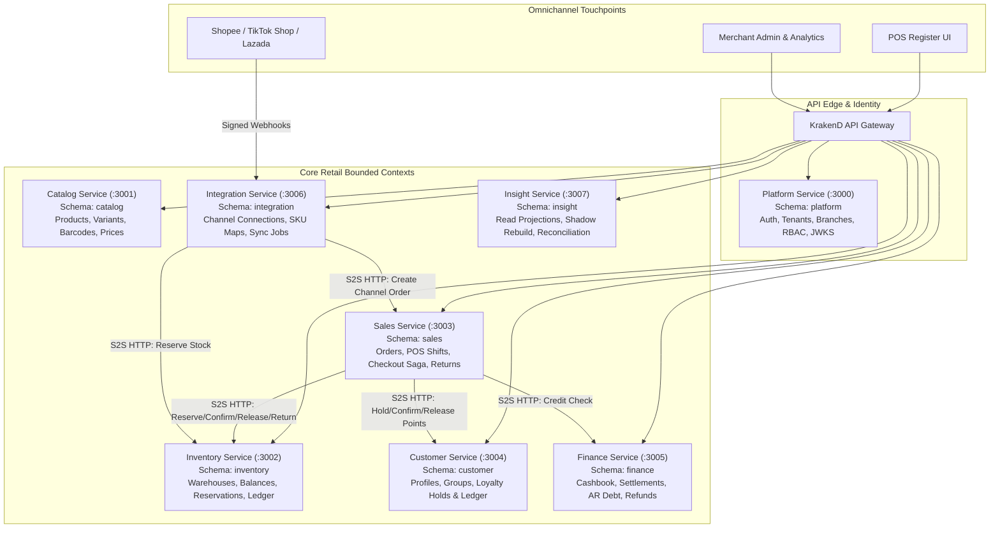
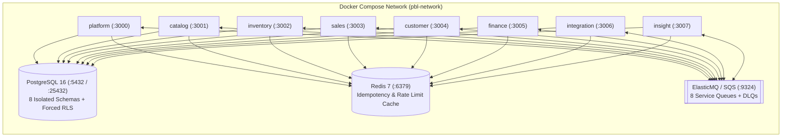
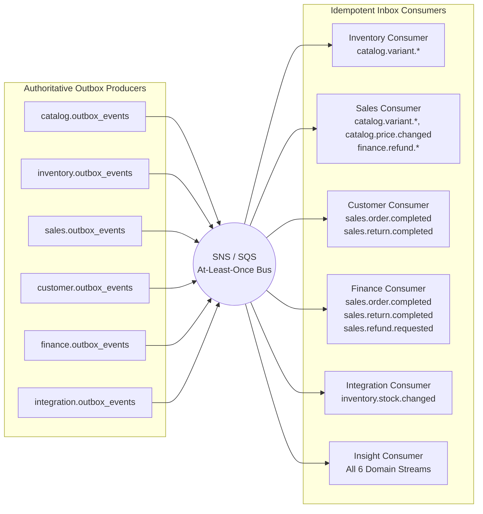

# M8 System Architecture — Bounded Contexts, Runtime Topology & Event Bus

**Milestone:** M8 — Full-System Integration, Distributed Reliability & Architecture Validation

---

## 1. Full System Context & Bounded Context Map (Diagram 1)

---

## 2. Local Docker Compose & Runtime Topology (Diagram 2)

---

## 3. Asynchronous Event Topology — Transactional Outbox to Consumers (Diagram 3)

---

## 4. Architectural Invariants Enforced

1. **Zero Cross-Service Code Imports**: Enforced by [`ddd-architecture-fitness.spec.ts`](file:///Users/mac/Desktop/SEM7/pbl6/pbl-api/libs/common/src/bootstrap/ddd-architecture-fitness.spec.ts).
2. **Zero Cross-Schema SQL Queries**: Every microservice connects to its own schema (`platform`, `catalog`, `inventory`, `sales`, `customer`, `finance`, `integration`, `insight`) and never queries another service's tables directly.
3. **Database-Level Multi-Tenant Isolation**: Every tenant-scoped table enforces `ENABLE ROW LEVEL SECURITY` and `FORCE ROW LEVEL SECURITY` keyed on `current_setting('app.current_tenant', true)` / `current_setting('app.tenant_id', true)`.
